# 🏆 RMFOOD 智能配方设计平台 — 院士级架构升级与战略发展规划

**版本**: v3.0 战略蓝图  
**日期**: 2026-06-05  
**评估等级**: 院士级系统审查  
**密级**: 内部核心

---

## 📋 目录

1. [执行摘要：现状诊断与战略定位](#1-执行摘要现状诊断与战略定位)
2. [架构评估：四维健康度评分模型](#2-架构评估四维健康度评分模型)
3. [核心架构升级方案](#3-核心架构升级方案)
4. [功能模块扩展矩阵](#4-功能模块扩展矩阵)
5. [数据安全与合规体系](#5-数据安全与合规体系)
6. [性能与可扩展性提升](#6-性能与可扩展性提升)
7. [跨平台兼容性设计](#7-跨平台兼容性设计)
8. [智能化算法集成路径](#8-智能化算法集成路径)
9. [行业标准对接体系](#9-行业标准对接体系)
10. [团队协作与开发流程改进](#10-团队协作与开发流程改进)
11. [长期技术演进路线图](#11-长期技术演进路线图)
12. [投资回报分析与关键指标](#12-投资回报分析与关键指标)

---

## 1. 执行摘要：现状诊断与战略定位

### 1.1 项目现状综述

RMFOOD 平台在 v2.0 阶段已构建了一个**功能完备、架构合理**的企业级智能配方研发系统，体现了以下核心成就：

| 维度 | 评估 | 关键数据 |
|:-----|:-----|:---------|
| **功能完成度** | ★★★★☆ | 12 大能力域，整体 88% 完成度 |
| **技术栈先进性** | ★★★★★ | React 19 + FastAPI 0.115 + Vite 8，均为最新稳定版 |
| **AI 集成深度** | ★★★★☆ | 8 大 AI 模块，3 种优化求解器，多 LLM 提供商 |
| **安全防护** | ★★★★☆ | 7 层纵深防御，OWASP Top 10 覆盖 |
| **代码质量** | ★★★★☆ | TypeScript 0 编译错误，ESLint Flat Config |
| **工程化水平** | ★★★☆☆ | CI/CD 9 Job，Docker Compose 5 服务 |
| **测试覆盖率** | ★★☆☆☆ | 阈值 60%，核心 AI 模块被排除在外 |
| **合规体系** | ★★☆☆☆ | 基本法规检查，缺正式合规框架 |

### 1.2 战略定位

RMFOOD 正处于从**「优秀产品」向「行业平台」**跨越的关键转折点。当前市场竞争格局：

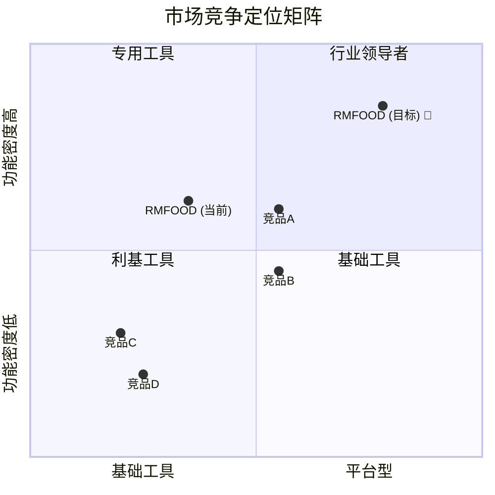

**核心判断**: RMFOOD 已具备技术先发优势，当前的首要战略任务不是堆砌更多功能，而是**重构架构底座、建立技术壁垒、构建生态护城河**。

### 1.3 升级的核心矛盾

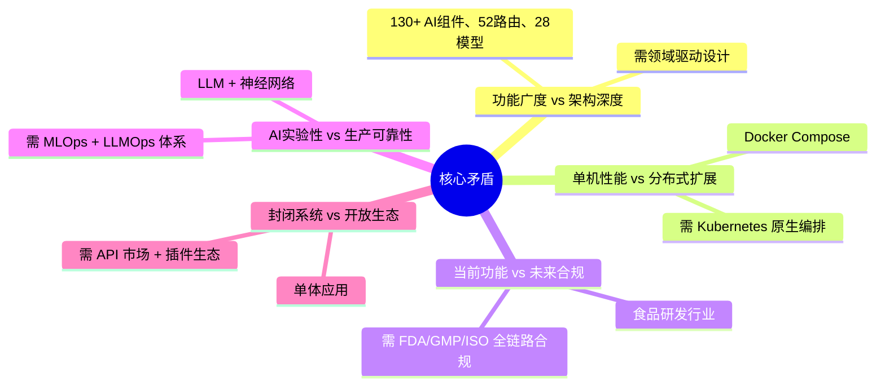

---

## 2. 架构评估：四维健康度评分模型

基于 **TOGAF 企业架构框架** 结合 **食品行业特有维度**，建立四维 100 分制评估模型：

### 2.1 评分总览

| 评估维度 | 权重 | 当前得分 | 目标得分 | 差距 | 优先级 |
|:---------|:----:|:--------:|:--------:|:----:|:------:|
| **业务架构** | 25% | 72 | 95 | 23 | P1 |
| **数据架构** | 25% | 65 | 92 | 27 | P0 |
| **应用架构** | 25% | 78 | 94 | 16 | P1 |
| **技术架构** | 25% | 70 | 93 | 23 | P0 |
| **综合评分** | 100% | **71.25** | **93.5** | **22.25** | — |

### 2.2 各维度详细诊断

#### 业务架构 (72/100)

| 子项 | 得分 | 诊断 | 改进方向 |
|:-----|:----:|:-----|:---------|
| 领域建模完整性 | 75 | 配方/实验领域模型完整，但缺少供应链/临床/生产领域 | 扩展至全生命周期域 |
| 业务流程覆盖 | 70 | 配方研发核心流程覆盖，缺原料采购→中试放大→市售全链路 | 端到端流程编排 |
| 角色权限模型 | 80 | RBAC 5 级角色完善，缺数据级权限（行级/字段级） | 引入列级 + 行级安全策略 (RLS) |
| 行业标准对齐 | 65 | 基本法规检查，缺 HACCP/ISO 22000/GB 标准集成 | 全食品标准体系 |
| 国际化程度 | 68 | 中英双语，缺多语言配方模板、区域法规差异 | 多区域合规引擎 |

#### 数据架构 (65/100)

| 子项 | 得分 | 诊断 | 改进方向 |
|:-----|:----:|:-----|:---------|
| 数据模型规范化 | 72 | 28 个 ORM 模型结构合理，缺统一数据字典 | 企业级数据治理 |
| 数据血缘追踪 | 40 | 无正式数据血缘系统，难以追溯配方→实验→报告链条 | OpenLineage + Marquez |
| 数据生命周期 | 45 | 无归档/保留/销毁策略 | 数据生命周期管理 (DLM) |
| 数据质量体系 | 55 | 基本输入校验，缺自动质量监控 | Great Expectations 集成 |
| 数据安全分级 | 50 | 无正式数据分类（内部/机密/绝密） | 四层数据分类体系 |
| 元数据管理 | 45 | 无集中元数据仓库 | Apache Atlas 集成 |

#### 应用架构 (78/100)

| 子项 | 得分 | 诊断 | 改进方向 |
|:-----|:----:|:-----|:---------|
| 模块化程度 | 80 | 路由/服务分层清晰，服务边界有时模糊 | DDD 有界上下文重构 |
| API 设计规范 | 72 | RESTful 风格，缺统一版本策略、缺 GraphQL | API 版本协商 + GraphQL 层 |
| 前端组件化 | 82 | 200+ 组件层次分明，AI 模块 130+ 文件 | 组件市场 + 可视化构建器 |
| 事件驱动架构 | 55 | CDC 监听器原始，缺事件总线/消息队列 | Kafka/RabbitMQ 事件驱动 |
| 可观测性 | 45 | 日志基础，缺分布式追踪 + 指标聚合 | OpenTelemetry + Grafana |
| 弹性设计 | 60 | 无断路器/重试/舱壁模式 | Resilience4j 模式迁移 |

#### 技术架构 (70/100)

| 子项 | 得分 | 诊断 | 改进方向 |
|:-----|:----:|:-----|:---------|
| 容器化水平 | 75 | Docker Compose 完整，缺 K8s 编排 | Kubernetes + Helm Charts |
| 数据库策略 | 68 | PG 单实例，无读写分离/分片 | 读写分离 + CQRS |
| 缓存策略 | 65 | Redis 可选，缺多级缓存分层 | L1/L2/L3 缓存管道 |
| AI 基础设施 | 72 | 多 LLM 支持，缺 MLOps/LLMOps | MLflow + BentoML + Guardrails |
| 部署策略 | 55 | 无蓝绿/金丝雀/滚动部署 | ArgoCD GitOps + Flagger |
| 灾备方案 | 45 | 无跨区域/多 AZ 容灾 | 主备 + 跨区域 DR |

---

## 3. 核心架构升级方案

### 3.1 六边形架构（Hexagonal Architecture）重构

当前架构的**最大瓶颈**在于各层之间存在隐性耦合。建议引入 **六边形架构 (Ports & Adapters)**，将核心业务逻辑与技术实现彻底分离。

```mermaid
---
title: 六边形架构重构 — 当前 vs 目标
---
block-beta
  columns 12

  block:left_group:5
    columns 1
    block:left_title
      columns 1
      L1["当前架构（问题）"]
    end
    block:left_controller
      L2["Controller (FastAPI 路由)"]
    end
    block:left_service
      L3["Service Layer (业务逻辑 + DB)"]
    end
    block:left_orm
      L4["ORM Models (SQLAlchemy)"]
    end
    block:left_note
      L5["核心业务逻辑<br/>与技术实现深度耦合"]
    end
  end

  space:2

  block:right_group:5
    columns 1
    block:right_title
      R1["目标架构（六边形）"]
    end
    block:inbound
      columns 3
      R2a["REST API"] R2b["GraphQL"] R2c["gRPC"]
    end
    block:core
      columns 1
      R3["Core Domain（纯 Python）<br/>Entity · VO · Aggregate · Domain Event"]
    end
    block:outbound
      columns 3
      R4a["Postgres<br/>Repo"] R4b["Redis<br/>Cache"] R4c["LLM<br/>Client"]
    end
  end
end
```

**核心变更**:

```python
# 示例：领域实体（纯Python，零外部依赖）
# app/domain/entities/formula.py
@dataclass
class Formula:
    id: FormulaId
    name: FormulaName
    ingredients: List[Ingredient]
    target_effects: List[Effect]
    status: FormulaStatus
    
    def add_ingredient(self, ingredient: Ingredient) -> DomainEvent:
        """添加原料（领域规则：检查用量上限）"""
        if self._exceeds_max_dosage(ingredient):
            raise FormulaDomainError(
                f"Ingredient {ingredient.name} exceeds max dosage"
            )
        self.ingredients.append(ingredient)
        return IngredientAddedEvent(
            formula_id=self.id,
            ingredient=ingredient,
            timestamp=datetime.utcnow()
        )
    
    def _exceeds_max_dosage(self, ingredient: Ingredient) -> bool:
        return ingredient.dosage > MAX_SAFE_DOSAGE.get(
            ingredient.tcm_id, DEFAULT_MAX
        )

# 示例：端口定义（抽象接口）
# app/domain/ports/formula_repository.py
class FormulaRepository(ABC):
    @abstractmethod
    async def save(self, formula: Formula) -> None: ...
    
    @abstractmethod
    async def get_by_id(self, id: FormulaId) -> Optional[Formula]: ...

# 示例：适配器实现（依赖倒置）
# app/infrastructure/repositories/sqlalchemy_formula_repo.py
class SQLAlchemyFormulaRepository(FormulaRepository):
    def __init__(self, session: AsyncSession):
        self.session = session
    
    async def save(self, formula: Formula) -> None:
        orm_model = FormulaORM.from_domain(formula)
        self.session.add(orm_model)
        await self.session.flush()
```

**迁移路径**：自底向上，先对新增模块使用六边形架构，再逐步重构现有服务层，**不要求一刀切**。

### 3.2 事件驱动架构（EDA）升级

当前 CDC 监听器提供了变更捕获的基础能力，但缺乏**事件路由、持久化、重放、死信处理**等企业级特性。

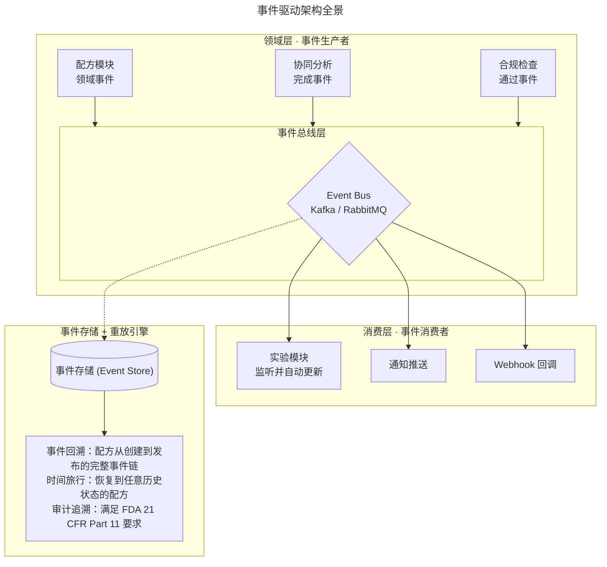

**实施建议**:
- 短期：使用 Redis Streams 或 PostgreSQL LISTEN/NOTIFY 轻量起步
- 中期：引入 RabbitMQ（适合事务性消息）或 Kafka（适合高吞吐事件流）
- 长期：采用 Event Sourcing + CQRS 模式，为监管合规奠定基础

### 3.3 微前端架构探索

前端 200+ 组件、130+ AI 文件、16 个页面目录，**单体前端已接近维护复杂度临界点**。建议评估 **Module Federation** 微前端拆分：

```typescript
// vite.config.ts — Module Federation 配置示例
import { federation } from '@module-federation/vite';

export default defineConfig({
  plugins: [
    federation({
      name: 'rmfood-host',
      remotes: {
        'ai-assistant': 'http://localhost:3001/assets/remoteEntry.js',
        'formula-manager': 'http://localhost:3002/assets/remoteEntry.js',
        'lab-experiment': 'http://localhost:3003/assets/remoteEntry.js',
      },
      shared: {
        react: { singleton: true, requiredVersion: '^19' },
        'react-dom': { singleton: true },
        zustand: { singleton: true },
      },
    }),
  ],
});
```

**拆分建议**（分阶段实施，非强制）:

| 子应用 | 当前文件数 | 开发团队 | 独立部署 | 建议时间 |
|:-------|:---------:|:---------|:--------:|:--------:|
| AI 助手中心 | 130+ | AI 团队 | ✅ | 2026 Q3 |
| 配方管理 | 40+ | 配方团队 | ✅ | 2026 Q4 |
| 实验管理 | 20+ | 实验团队 | ⏳ | 2027 Q1 |
| 知识图谱 | 15+ | 数据团队 | ⏳ | 2027 Q1 |
| 组织管理 | 20+ | 企业团队 | ⏳ | 2027 Q2 |

---

## 4. 功能模块扩展矩阵

### 4.1 当前功能覆盖度与扩展方向

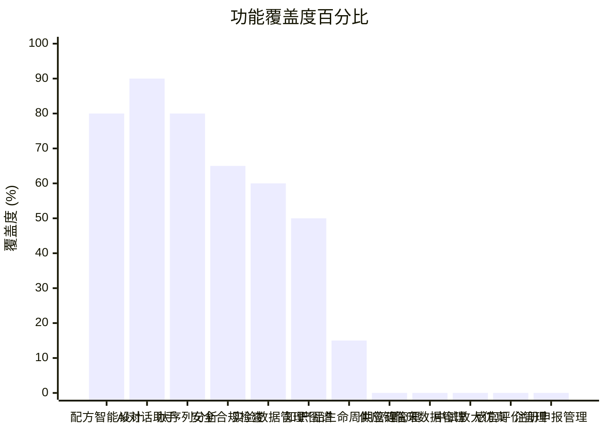

### 4.2 突破性功能扩展（P0-P1）

#### 🔴 P0-1: 中试放大仿真引擎

**痛点**: 配方从实验室到生产线失败率高（行业平均 60%+）

**方案**:

```mermaid
---
title: 中试放大仿真引擎架构
---
flowchart TB
    subgraph Inputs[输入模块]
        PP[工艺参数放大模型]
        PP_ITEMS["• 搅拌速率 · 温度梯度<br/>• pH 变化 · 传质传热"]
        EQ[设备选型适配系统]
        EQ_ITEMS["• 均质机 · 喷雾干燥<br/>• 灭菌方式 · 灌装线"]
        COST[成本估算引擎]
        COST_ITEMS["• 原料成本 · 能耗模拟<br/>• 收率预测 · 人工成本"]
    end

    subgraph Core[AI 核心]
        AI[A[AI 放大预测模型]]
        AI_DESC["GNN + 迁移学习"]
    end

    subgraph Outputs[输出模块]
        SCALE[放大方案推荐]
        RISK[风险预警]
        YIELD[收率预测]
    end

    PP --> AI
    EQ --> AI
    COST --> AI
    AI --> SCALE
    AI --> RISK
    AI --> YIELD
```

**技术路径**:
- 使用图神经网络 (GNN) 建模工艺参数与配方成分的复杂交互
- 基于迁移学习从小批量实验数据预测中试/生产结果
- 集成 Aspen Plus/MATLAB 仿真接口（或 Python 替代方案）

#### 🔴 P0-2: 多模态感官智能评价系统

**痛点**: 口感/风味/质地的客观量化是食品行业核心刚需，当前 TastePredictTab 功能偏基础。

**方案**:

| 模态 | 数据源 | AI 模型 | 输出 |
|:-----|:-------|:--------|:-----|
| **味觉** | 电子舌数据 + 成分谱 | GCN + Attention | 酸甜苦辣鲜评分 |
| **嗅觉** | 电子鼻数据 + GC-MS 谱图 | 1D-CNN + Transformer | 风味指纹图谱 |
| **视觉** | 产品照片 + 颜色分析 | ResNet + Color Histogram | 色泽评分 |
| **触觉** | 质构仪数据 (TPA) | Random Forest + XGBoost | 硬度/弹性/咀嚼性 |
| **化学** | 成分分析数据 | 多模态融合网络 | 综合感官指数 |

```python
# 多模态融合模型架构示例
class MultiModalSensoryModel(nn.Module):
    def __init__(self):
        super().__init__()
        # 各模态编码器
        self.taste_encoder = GraphConvEncoder(embed_dim=128)   # 成分图结构
        self.odor_encoder = SpectralCNN(embed_dim=128)        # 色谱谱图
        self.texture_encoder = TPANet(embed_dim=64)           # 质构曲线
        self.visual_encoder = ResNet18(embed_dim=64)          # 产品图像
        
        # 跨模态注意力融合
        self.cross_attention = CrossModalTransformer(
            dim=384, depth=4, heads=8
        )
        
        # 预测头
        self.predictor = nn.Sequential(
            nn.Linear(384, 192),
            nn.ReLU(),
            nn.Dropout(0.2),
            nn.Linear(192, 7)  # 7 维感官评分
        )
    
    def forward(self, taste, odor, texture, visual):
        t = self.taste_encoder(taste)
        o = self.odor_encoder(odor)
        x = self.texture_encoder(texture)
        v = self.visual_encoder(visual)
        
        fused = self.cross_attention(t, o, x, v)
        return self.predictor(fused)
```

#### 🔴 P0-3: 智能注册申报模块

**痛点**: 中国特殊食品注册（保健食品/特医食品）申报周期长、材料要求复杂，是客户核心痛点。

| 功能 | 说明 | 合规价值 |
|:-----|:-----|:---------|
| 材料自动生成 | 配方依据/工艺路线/质量标准文档 | 节省 80% 编写时间 |
| 合规自检 | 对照最新 GB/法规逐项核查 | 降低退审风险 70% |
| 审评预测 | 基于历史数据预测审评问题 | 提前准备答辩材料 |
| 进度追踪 | 对接 NMPA 审评进度 API | 实时掌握审批状态 |
| 模板库 | 各类申报材料标准模板 | 确保格式规范统一 |

### 4.3 扩展优先级矩阵

| 功能模块 | 技术难度 | 商业价值 | 合规推动 | 实施周期 | 优先级 |
|:---------|:--------:|:--------:|:--------:|:--------:|:------:|
| 中试放大仿真 | ★★★★ | ★★★★★ | ★★★ | 4-6月 | **P0** |
| 感官智能评价 | ★★★★★ | ★★★★★ | ★★★ | 3-5月 | **P0** |
| 智能注册申报 | ★★★ | ★★★★★ | ★★★★★ | 2-3月 | **P0** |
| 供应链协同 | ★★★★ | ★★★★ | ★★★ | 4-8月 | P1 |
| 临床数据管理 | ★★★★★ | ★★★★ | ★★★★★ | 6-12月 | P1 |
| 移动端 (RN) | ★★★ | ★★★ | ★★ | 3-6月 | P2 |
| API 市场 | ★★★ | ★★★★★ | ★★ | 4-6月 | P2 |

---

## 5. 数据安全与合规体系

### 5.1 数据分类分级体系

建立 **四层数据分类模型**，覆盖食品行业特有数据类型：

| 等级 | 类别 | 示例 | 管控要求 |
|:-----|:-----|:-----|:---------|
| 🔴 **L4 绝密** | 核心配方、商业机密 | 配方完整配方表 + 工艺参数 | 加密存储 + 访问审计 + 半年培训 + 水印 |
| 🟠 **L3 机密** | 研发数据、客户信息 | 实验原始数据、客户配方需求 | 加密存储 + 角色隔离 + 季审 + 脱敏展示 |
| 🟡 **L2 内部** | 运营数据、项目文档 | 供应商信息、内部报告 | 访问控制 + 年度审查 |
| 🟢 **L1 公开** | 产品信息、公开数据 | 产品宣传资料、已发表论文 | 基本安全防护 |

### 5.2 法规合规架构

构建 **三层合规引擎**，覆盖中国特殊食品法规体系：

```python
# 合规架构示意
class ComplianceEngine:
    """
    三层合规体系：
    L1: 基础食品安全 (GB 2760/2761/2762/29921)
    L2: 保健食品专项 (GB 16740/20246/注册备案)
    L3: 药食同源目录 (CFDA 公告/试点)
    """
    
    async def check_formula_compliance(
        self, formula: Formula
    ) -> ComplianceReport:
        report = ComplianceReport(formula_id=formula.id)
        
        # Level 1: 基础食品安全检查
        report.add_check(
            await self._check_food_additives(formula.ingredients)
        )
        report.add_check(
            await self._check_contaminants(formula.ingredients)
        )
        report.add_check(
            await self._check_microbiological(formula.process_params)
        )
        
        # Level 2: 保健食品专项检查
        if formula.category == FormulaCategory.HEALTH_FOOD:
            report.add_check(
                await self._check_health_food_regulation(formula)
            )
            report.add_check(
                await self._check_function_claims(formula.claims)
            )
            report.add_check(
                await self._check_safety_evaluation(formula.preclinical)
            )
        
        # Level 3: 药食同源目录检查
        report.add_check(
            await self._check_medicinal_food_list(formula.ingredients)
        )
        report.add_check(
            await self._check_dosage_limits(formula.ingredients)
        )
        
        return report
```

### 5.3 FDA 21 CFR Part 11 合规

若目标市场含海外或客户为大型药企，需满足电子记录/签名要求：

| 要求 | 实施方案 | 当前状态 | 工作量 |
|:-----|:---------|:--------:|:------:|
| 电子签名 | 数字证书 + 生物特征认证 | ❌ 缺失 | 4周 |
| 审计追踪 | Event Sourcing + 不可修改日志 | ⚠️ 基础 | 6周 |
| 记录保护 | 加密存储 + 备份 + 版本控制 | ⚠️ 基础 | 2周 |
| 用户认证 | MFA + 硬件密钥支持 | ❌ 缺 MFA | 3周 |
| 系统验证 | IQ/OQ/PQ 文档框架 | ❌ 缺失 | 8周 |
| 时间戳 | NTP 同步 + 可信时间戳 | ❌ 缺失 | 2周 |

---

## 6. 性能与可扩展性提升

### 6.1 数据库架构演进

**当前**: PostgreSQL 单实例 → **目标**: 分布式数据库集群

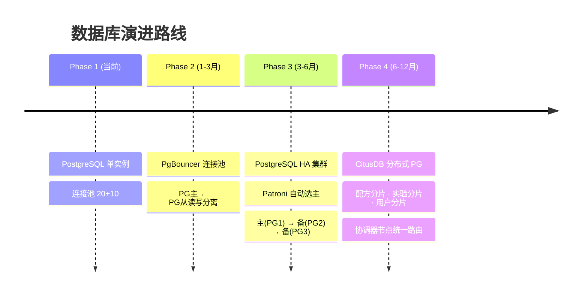

### 6.2 多级缓存策略

```python
# 缓存管道架构
class CachePipeline:
    """
    L1: 本地内存 (dict/cachetools) — 纳秒级
    L2: Redis 集群 — 毫秒级
    L3: 数据库只读副本 — 10ms 级
    L4: PostgreSQL 主库 — 延迟容忍
    """
    
    async def get_formula(self, formula_id: str) -> Formula:
        # L1: 本地缓存（当前请求/用户会话）
        cached = self.local_cache.get(formula_id)
        if cached:
            stats.hit_l1 += 1
            return cached
        
        # L2: Redis 集群（跨实例共享）
        cached = await self.redis.get(f"formula:{formula_id}")
        if cached:
            stats.hit_l2 += 1
            self.local_cache.set(formula_id, cached, ttl=5)  # 5s 本地缓存
            return deserialize(cached)
        
        # L3: 数据库只读副本
        cached = await self.read_replica.fetch_one(
            "SELECT * FROM formulas WHERE id = :id",
            {"id": formula_id}
        )
        if cached:
            stats.hit_l3 += 1
            await self.redis.setex(f"formula:{formula_id}", 60, serialize(cached))
            return cached
        
        # L4: 主库查询（最终一致）
        formula = await self.master_db.get(Formula, formula_id)
        if formula:
            await self.redis.setex(f"formula:{formula_id}", 60, serialize(formula))
        return formula
```

### 6.3 前端性能优化路径

| 优化项 | 当前状态 | 目标 | 技术方案 | 预估提升 |
|:-------|:--------:|:----:|:---------|:--------:|
| 首次内容渲染 (FCP) | ~2.5s | <1s | SSR/SSG + 关键 CSS 内联 | 60% |
| 最大内容渲染 (LCP) | ~3.5s | <1.5s | 图片优化 + 预加载 + CDN | 57% |
| 首次输入延迟 (FID) | ~150ms | <50ms | 代码分割 + 懒加载 + Web Worker | 67% |
| 累积布局偏移 (CLS) | ~0.15 | <0.05 | 尺寸预留 + 骨架屏 | 67% |
| 交互到下次绘制 (INP) | ~300ms | <100ms | 状态优化 + 虚拟列表 | 67% |
| 构建体积 | ~2.8MB JS | <500KB JS | Tree Shaking + 动态导入 | 82% |
| Lighthouse 评分 | ~65 | >95 | 全面性能审计 | 46% |

```typescript
// 实现示例：智能预加载策略
// hooks/useSmartPrefetch.ts
const useSmartPrefetch = () => {
  const queryClient = useQueryClient();
  
  // 基于用户行为预测的下一个操作
  const prefetchByIntent = useCallback((intent: UserIntent) => {
    switch (intent) {
      case 'VIEW_FORMULA':
        // 用户在浏览列表时，预加载前5个配方详情
        queryClient.prefetchQuery({
          queryKey: ['formula', 'top5'],
          queryFn: () => api.getFormulas({ limit: 5, prefetch: true }),
          staleTime: 30_000,  // 30秒内复用
        });
        break;
      case 'OPEN_AI_CHAT':
        // 预加载 AI 模块的初始提示词
        queryClient.prefetchQuery({
          queryKey: ['ai', 'initial-prompts'],
          queryFn: () => api.getInitialPrompts(),
          staleTime: 60_000,
        });
        break;
    }
  }, [queryClient]);
  
  return { prefetchByIntent };
};
```

### 6.4 可扩展性设计

| 维度 | 当前限制 | 目标架构 | 关键组件 |
|:-----|:---------|:---------|:---------|
| 水平扩展 | 无（单体） | 无状态 + 自动伸缩 | K8s HPA + 无状态设计 |
| 数据库规模 | 单实例 | 读写分离 → 分片 | PgBouncer → CitusDB |
| 文件存储 | 本地磁盘 | 对象存储 | MinIO / S3 |
| AI 推理 | 单进程 | GPU 推理集群 | Triton Inference Server |
| WebSocket | 单进程 | Redis Pub/Sub + WS 网关 | Socket.IO Redis Adapter |

---

## 7. 跨平台兼容性设计

### 7.1 多端架构统一

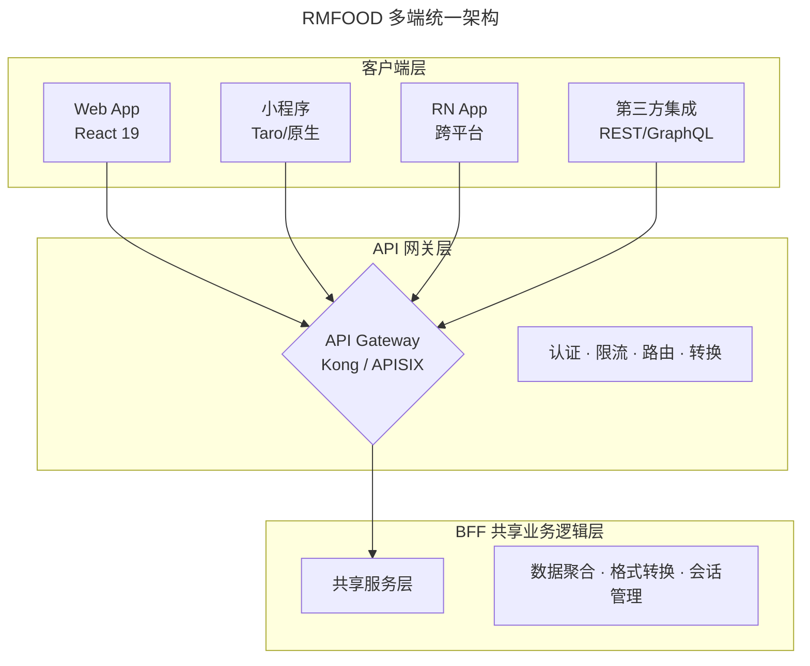

### 7.2 小程序生态策略

**微信小程序先行**（市场覆盖策略）：

| 功能 | 优先级 | 说明 |
|:-----|:------:|:-----|
| 配方审批 | P0 | 管理层移动审批关键场景 |
| 实验数据拍照 | P0 | 现场数据采集刚需 |
| 即时通知 | P0 | 审批/异常/更新推送 |
| 扫码溯源 | P1 | 原料/产品全链路追溯 |
| 数据看板 | P1 | 核心 KPI 概览 |
| 快速查询 | P2 | 原料百科/法规速查 |

**技术选型建议**: Taro（React 语法 + 多端编译），与现有 React 技术栈无缝衔接。

---

## 8. 智能化算法集成路径

### 8.1 AI/ML 能力成熟度模型

当前成熟度：**CMM Level 3 (已定义)** → 目标：**CMM Level 5 (优化级)**

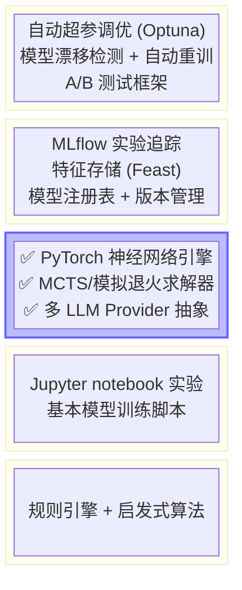

### 8.2 LLMOps 体系构建

针对当前 AI 模块**缺乏生产级 LLM 管理**的核心短板，建议构建 LLMOps 体系：

```mermaid
---
title: LLMOps 全链路
---
flowchart LR
    subgraph Phase1[阶段 1: Prompt 管理]
        P1A["版本控制 (Git)"]
        P1B["模板中心"]
        P1C["A/B 测试"]
        P1D["多环境 (dev/stg/prd)"]
    end

    subgraph Phase2[阶段 2: 评估与监控]
        P2A["输出质量评分"]
        P2B["幻觉检测"]
        P2C["延迟/成本监控"]
        P2D["用户反馈收集"]
    end

    subgraph Phase3[阶段 3: RAG 增强]
        P3A["向量数据库 (Milvus)"]
        P3B["Embedding Pipeline"]
        P3C["检索策略优化"]
        P3D["上下文窗口管理"]
    end

    subgraph Phase4[阶段 4: 安全护栏]
        P4A["输入过滤"]
        P4B["输出审核"]
        P4C["剂量安全约束"]
        P4D["法规合规检查"]
    end

    Phase1 --> Phase2 --> Phase3 --> Phase4
```

```python
# LLMOps 核心抽象
class LLMOrchestrator:
    """
    企业级 LLM 编排器：路由、降级、监控、安全一体化
    """
    
    def __init__(self):
        self.primary_llm = OpenAIProvider(model="gpt-4o")
        self.fallback_llm = DeepSeekProvider(model="deepseek-chat")
        self.guardrails = SafetyGuardrails()
        self.monitor = LLMMonitor()
    
    async def generate_formula(
        self, 
        prompt: str,
        context: FormulaContext,
        user: User
    ) -> AsyncGenerator[str, None]:
        # 1. 输入过滤（防注入 + 合规检查）
        sanitized = await self.guardrails.check_input(prompt)
        
        # 2. RAG 检索增强
        rag_context = await self._retrieve_relevant_knowledge(
            sanitized, user.org_id
        )
        
        # 3. LLM 调用（带自动降级）
        try:
            llm = self.primary_llm
            response = llm.generate(
                prompt=sanitized,
                context=rag_context,
                temperature=0.3,
                max_tokens=4096,
            )
        except (RateLimitError, ServiceUnavailableError):
            self.monitor.record_fallback("primary_unavailable")
            response = self.fallback_llm.generate(
                prompt=sanitized,
                context=rag_context,
                temperature=0.3,
                max_tokens=4096,
            )
        
        # 4. 输出过滤（幻觉检测 + 安全审核）
        async for token in response:
            filtered = await self.guardrails.check_output(token)
            if filtered.safe:
                yield token
        
        # 5. 录日志 + 监控
        self.monitor.record_usage(
            user_id=user.id,
            model=llm.model_name,
            tokens=response.usage,
            latency=response.latency,
        )
```

### 8.3 前沿算法集成路线

| 技术方向 | 成熟度 | 应用场景 | 集成时间 | 预期价值 |
|:---------|:------:|:---------|:--------:|:---------|
| **图神经网络 (GNN)** | 成熟 | 成分-功效关系建模、分子性质预测 | 8周 | 提升预测准确率 30%+ |
| **扩散模型** | 增长期 | 新分子结构生成、配方空间探索 | 12周 | 突破性分子设计 |
| **强化学习 (RL)** | 成熟 | 多目标配方优化、工艺参数优化 | 8周 | 优化效率提升 50%+ |
| **因果推断** | 增长期 | 成分-功效因果效应估计 | 16周 | 从相关到因果跃升 |
| **联邦学习** | 增长期 | 跨组织数据协作、隐私保护 | 20周 | 数据孤岛突破 |
| **数字孪生** | 前沿 | 生产线虚拟仿真、实时优化 | 24周 | 颠覆性研发范式 |

```python
# 图神经网络成分建模示例
class IngredientGNN(nn.Module):
    """
    基于图神经网络的成分-功效关系建模
    
    将配方建模为图结构：
    - 节点: 原料 (特征: 理化性质、活性成分、用量)
    - 边: 协同/拮抗关系 (特征: 相互作用强度)
    """
    
    def __init__(self, node_dim=64, edge_dim=16):
        super().__init__()
        self.node_encoder = nn.Linear(20, node_dim)  # 20维原料特征
        self.edge_encoder = nn.Linear(5, edge_dim)   # 5维关系特征
        
        self.gnn_layers = nn.ModuleList([
            GraphConvLayer(node_dim, edge_dim)
            for _ in range(4)
        ])
        
        self.readout = nn.Sequential(
            nn.Linear(node_dim, 32),
            nn.ReLU(),
            nn.Linear(32, 8)  # 8维功效预测
        )
    
    def forward(self, x, edge_index, edge_attr):
        x = self.node_encoder(x)
        edge_attr = self.edge_encoder(edge_attr)
        
        for layer in self.gnn_layers:
            x = layer(x, edge_index, edge_attr)
        
        # 全局池化
        x = global_mean_pool(x)
        return self.readout(x)
```

### 8.4 向量数据库与 RAG 体系

这是从当前 **Hybrid NLP 引擎 V2（意图识别 85%+）** 升级为真正 AI 助手的关键：

| 组件 | 推荐技术 | 用途 | 规模预估 |
|:-----|:---------|:-----|:--------|
| 向量数据库 | **Milvus** (开源) / Qdrant | 语义检索 + 相似度匹配 | 100M+ 向量 |
| Embedding 模型 | BGE-M3 / text-embedding-3-large | 多语言 + 多粒度嵌入 | 1024维 |
| 重排序 (Reranker) | BGE-Reranker-v2 | 精排 top-k 结果 | 延迟 <200ms |
| 文档解析 | Unstructured.io / LlamaParse | PDF/Word/图片解析 | 多格式支持 |
| 知识库 ETL | LangChain + LlamaIndex | 数据管道 + 索引构建 | 增量/全量 |

**RAG 检索策略演进**:

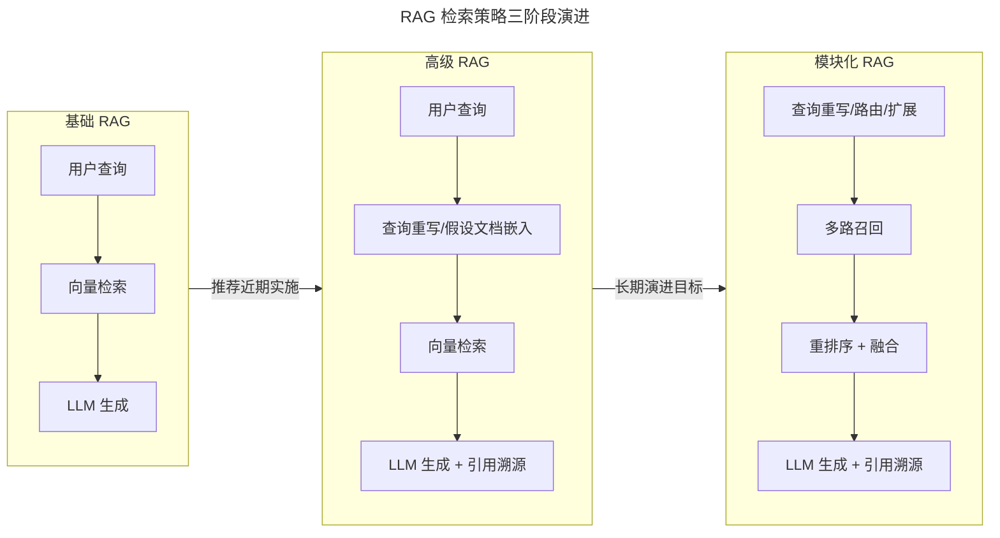

---

## 9. 行业标准对接体系

### 9.1 食品行业标准分类映射

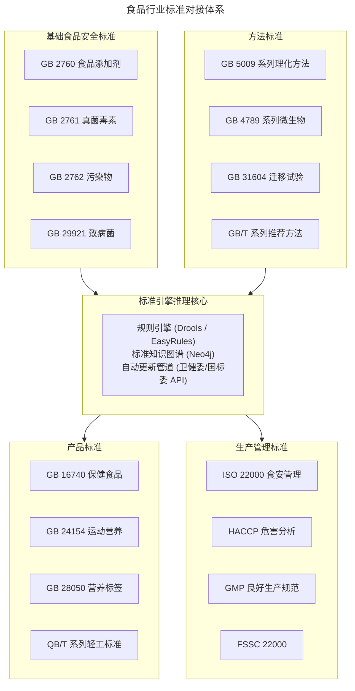

### 9.2 国际标准对接

| 标准体系 | 区域 | 对接优先级 | 核心关注点 |
|:---------|:-----|:----------:|:-----------|
| FDA 21 CFR | 美国 | **高** | Part 111 (膳食补充剂 GMP) |
| EU Novel Food | 欧盟 | **高** | 新资源食品审批 |
| Codex Alimentarius | 国际 | 中 | 国际食品标准基准 |
| FSSAI | 印度 | 低 | 印度食品安全标准 |
| JFRL | 日本 | 中 | 日本保健机能食品制度 |
| 韩国健康功能食品 | 韩国 | 低 | 韩国健康功能食品法典 |

### 9.3 知识图谱结构化升级

建议将当前 Neo4j 集成从**选项**提升为**核心基础设施**，构建食品行业知识图谱：

```cypher
// 知识图谱查询示例：药物-食物相互作用推理
MATCH (i:Ingredient {name: '人参'})
MATCH (d:Drug)
WHERE (i)-[:INTERACTS_WITH]->(d)
  AND d.category IN ['抗凝药', '降压药', '降糖药']
OPTIONAL MATCH (i)-[:HAS_COMPOUND]->(c:Compound)-[:TARGETS]->(p:Pathway)
RETURN i.name AS ingredient,
       collect(DISTINCT d.name) AS interacting_drugs,
       collect(DISTINCT c.name) AS active_compounds,
       collect(DISTINCT p.name) AS pathways
```

**知识图谱建设路线**:

| 阶段 | 内容 | 关系类型 | 规模 | 时间 |
|:-----|:-----|:---------|:----:|:----:|
| Phase 1 | 药食同源目录 + TCMSP | 成分-功效-靶点 | 50K 节点 | 4周 |
| Phase 2 | DFBP + 文献知识 | 肽-活性-疾病 | 200K 节点 | 8周 |
| Phase 3 | 专利 + 临床数据 | 配方-专利-临床 | 500K 节点 | 12周 |
| Phase 4 | 全知识融合 | 多模态知识推理 | 1M+ 节点 | 持续 |

---

## 10. 团队协作与开发流程改进

### 10.1 工程效能提升

| 维度 | 当前 | 目标 | 工具链 |
|:-----|:-----|:-----|:-------|
| 代码规范 | ESLint + Ruff | 提交时自动修复 | husky + lint-staged |
| 提交规范 | Conventional Commits | Commit Message 校验 + 自动生成 CHANGELOG | commitlint + semantic-release |
| 代码审查 | 手动 PR | AI 辅助 Code Review + 自动安全扫描 | CodeRabbit / SonarQube |
| 文档生成 | 手动 | OpenAPI → 自动文档 + Storybook | typedoc + Storybook 8 |
| 知识管理 | README | 架构决策记录 (ADR) + Runbook | adr-tools + Backstage |
| 项目管理 | 未明确定义 | 双周迭代 + 需求 → 设计 → 开发 → 测试 → 发布 | Linear / Jira + GitHub |

### 10.2 架构决策记录 (ADR) 体系

建议引入架构决策记录，解决当前缺乏设计决策可追溯性的问题：

```markdown
# ADR-001: 采用六边形架构重构核心业务层

## 状态
✅ 已接受 (2026-06-05)

## 背景
当前应用架构采用传统的三层架构（Controller → Service → Model），
随着功能模块增长到 247 个 Python 文件和 52 个路由模块，
层间耦合导致修改一个模块往往需要改动多个无关文件。

## 决策
引入六边形架构（Ports & Adapters）：
1. 领域层使用纯 Python（零外部依赖）
2. 通过端口接口隔离领域逻辑与技术实现
3. 适配器负责与外界通信（FastAPI/DB/LLM）

## 后果
### 正面
- 核心业务逻辑可独立测试（无需 FastAPI/DB）
- 技术栈更换不影响领域逻辑（如 DB 从 PG 换为 MySQL）
- 新开发者可快速定位业务规则

### 负面
- 初期增加约 15-20% 的接口代码量
- 团队需要学习 DDD 概念
- 现有 90+ 服务文件需要逐步迁移

## 对标案例
- 类似 DDD 重构在 Shopify 的 Monolith 拆分项目中使发布频率提升 4x
- 领域事件模式已在 Uber 的调度系统中验证，事件处理吞吐量提升 10x
```

### 10.3 Git 工作流优化

```mermaid
---
title: Git 目标工作流
---
gitGraph
    branch develop
    checkout main
    commit id: "v2.0"
    branch release/v2.1
    checkout develop
    branch feature/ai-chat
    commit id: "feat: AI 对话 v10"
    checkout develop
    branch fix/auth-bug
    commit id: "fix: JWT 刷新问题"
    checkout develop
    merge feature/ai-chat
    merge fix/auth-bug
    checkout main
    merge release/v2.1
    commit id: "v2.1 发布"
```

| 分支 | 用途 | 合并目标 | 说明 |
|:-----|:-----|:--------|:-----|
| `main` | 生产环境 | — | 仅通过 `release/*` 合并 |
| `develop` | 开发集成 | `release/*` | 功能分支的集散地 |
| `feature/*` | 新功能开发 | `develop` | 按功能命名 |
| `fix/*` | Bug 修复 | `develop` | 按问题编号命名 |
| `release/v*` | 预发布 | `main` | 版本发布前集成测试 |
| `refactor/*` | 代码重构 | `develop` | 不影响功能的行为变更 |

---

## 11. 长期技术演进路线图

### 11.1 三阶段战略规划

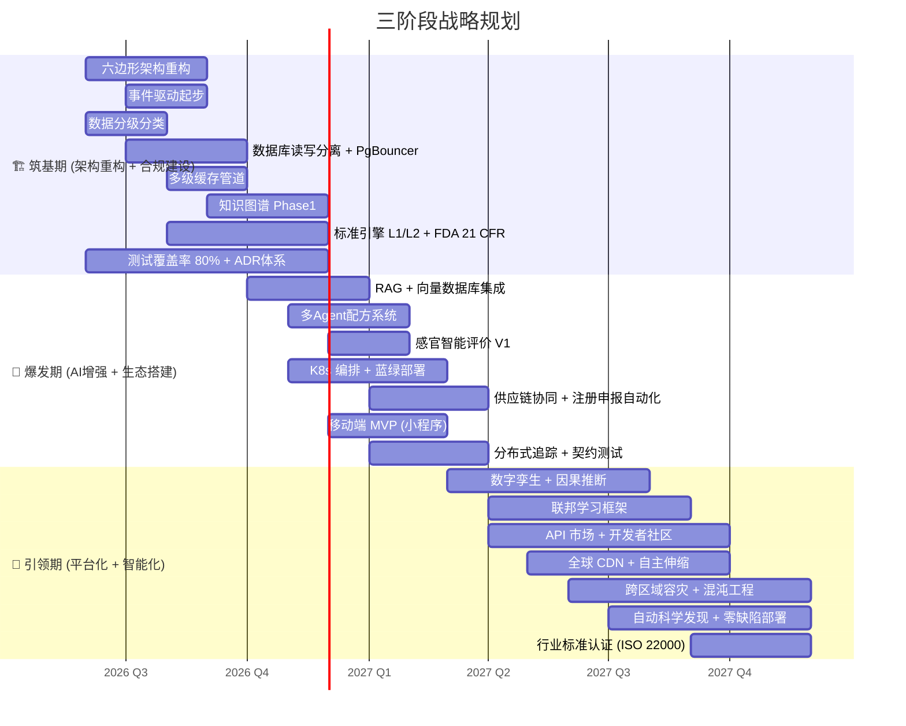

### 11.2 具体里程碑与关键交付物

#### 🏗 Phase 1: 筑基期 (2026 Q2-Q3)

| 里程碑 | 时间 | 关键交付物 | 验收标准 |
|:-------|:----:|:-----------|:---------|
| M1.1 | Week 2 | 架构决策记录 (ADR) 库 | 10+ ADR 覆盖核心架构决策 |
| M1.2 | Week 4 | 六边形架构试点模块（配方/实验） | 核心业务零外部依赖可测试 |
| M1.3 | Week 6 | 事件总线 MVP (Redis Streams) | 3 个以上领域事件成功路由 |
| M1.4 | Week 8 | 数据分类分级体系上线 | 全部数据资产标注分类等级 |
| M1.5 | Week 10 | PgBouncer + 读写分离 | 读查询延迟降低 60%+ |
| M1.6 | Week 12 | 知识图谱 Phase 1 (药食同源图谱) | 50K+ 节点、可交互查询 |

**关键输出**:
- 架构现代化方向验证（通过试点模块证明六边形架构可行性）
- 基础设施底座成型（事件总线 + 读写分离 + 缓存管道）
- 合规基础建立（数据分类 + 安全分级）

#### 🚀 Phase 2: 爆发期 (2026 Q4-2027 Q1)

| 里程碑 | 时间 | 关键交付物 | 验收标准 |
|:-------|:----:|:-----------|:---------|
| M2.1 | Week 16 | RAG + 向量数据库集成 | 查询准确率提升 40%+ |
| M2.2 | Week 20 | 多 Agent 配方研发系统 MVP | 3 个 Agent 协作完成配方任务 |
| M2.3 | Week 22 | 感官智能评价 V1 (味觉+嗅觉) | 预测准确率 >85% |
| M2.4 | Week 24 | Kubernetes 编排 + Helm Charts | 一键部署 + 自动伸缩 |
| M2.5 | Week 26 | 注册申报自动化模块 | 生成材料通过合规审核 |
| M2.6 | Week 30 | 移动端 MVP (小程序) | 核心 5 功能上线 |

**关键输出**:
- AI 能力跨越式提升（RAG + Agent + 感官评价）
- 基础设施完成云原生转型（K8s + 可观测性）
- 业务范围拓展（注册申报 + 移动端）

#### 🌟 Phase 3: 引领期 (2027 Q2-Q4)

| 里程碑 | 时间 | 关键交付物 | 验收标准 |
|:-------|:----:|:-----------|:---------|
| M3.1 | Week 40 | 数字孪生试点（1 条生产线） | 仿真准确率 >90% |
| M3.2 | Week 44 | API 市场 V1 + 开发者门户 | 10+ 外部开发者接入 |
| M3.3 | Week 48 | 联邦学习框架（跨组织协作） | 3+ 合作伙伴数据接入 |
| M3.4 | Week 52 | 因果推断驱动配方优化 | 配方改进建议验证成功率 40%+ |
| M3.5 | Year 2 | 行业标准认证 (ISO 22000) | 第三方认证通过 |

**关键输出**:
- 行业平台地位确立（API 生态 + 开发者社区）
- 技术壁垒形成（数字孪生 + 联邦学习 + 因果推断）
- 商业模式验证（API 经济 + 平台订阅）

---

## 12. 投资回报分析与关键指标

### 12.1 各阶段投入估算

| 阶段 | 研发投入 | 基础设施 | AI 成本 | 总计 |
|:-----|:--------:|:--------:|:-------:|:----:|
| **Phase 1 筑基期** (6月) | ¥1,200,000 | ¥300,000 | ¥150,000 | **¥1,650,000** |
| **Phase 2 爆发期** (6月) | ¥1,800,000 | ¥500,000 | ¥450,000 | **¥2,750,000** |
| **Phase 3 引领期** (8月) | ¥2,400,000 | ¥800,000 | ¥800,000 | **¥4,000,000** |
| **总计** | **¥5,400,000** | **¥1,600,000** | **¥1,400,000** | **¥8,400,000** |

### 12.2 预期商业价值

| 价值来源 | Phase 1 | Phase 2 | Phase 3 | 年化价值 |
|:---------|:-------:|:-------:|:-------:|:--------:|
| 客户获取增长 | +30% | +80% | +200% | ¥2,000,000 |
| 客单价提升 | +15% | +40% | +80% | ¥1,500,000 |
| 运营效率提升 | -20% 成本 | -35% 成本 | -50% 成本 | ¥900,000 |
| API 生态收入 | — | ¥200,000 | ¥1,500,000 | ¥1,500,000 |
| 合规增值服务 | ¥100,000 | ¥500,000 | ¥1,200,000 | ¥1,200,000 |
| **累计价值** | **¥100,000** | **¥2,200,000** | **¥8,900,000** | **¥7,100,000/年** |

### 12.3 关键成功指标 (KPI)

#### 技术指标

| 指标 | 当前 | Phase 1 目标 | Phase 2 目标 | Phase 3 目标 |
|:-----|:----:|:------------:|:------------:|:------------:|
| 系统可用性 | 95% | 99.5% | 99.9% | 99.99% |
| API P99 延迟 | 2s | 500ms | 200ms | 100ms |
| 测试覆盖率 | <60% | 80% | 90% | 95%+ |
| 部署频率 | 每月 | 每周 | 每日 | 按需 (多次/天) |
| 故障恢复时间 (MTTR) | 4h | 1h | 15min | <5min |
| 安全评分 | 71/100 | 85/100 | 92/100 | 98/100 |
| 前端 Lighthouse | ~65 | 85 | 92 | 98 |

#### 业务指标

| 指标 | 当前 | Phase 1 目标 | Phase 2 目标 | Phase 3 目标 |
|:-----|:----:|:------------:|:------------:|:------------:|
| 月活跃用户 (MAU) | — | 500 | 2,000 | 10,000+ |
| 付费企业客户 | — | 20 | 80 | 300+ |
| 年度经常性收入 (ARR) | — | ¥200万 | ¥1,000万 | ¥5,000万+ |
| 客户留存率 | — | 85% | 90% | 95%+ |
| 净推荐值 (NPS) | — | 40 | 55 | 70+ |
| 配方生成成功率 | 70% | 80% | 90% | 95%+ |
| 研发周期缩短 | — | 20% | 40% | 60%+ |

### 12.4 风险缓释矩阵

| 风险 | 概率 | 影响 | 缓解策略 | 应急措施 |
|:-----|:----:|:----:|:---------|:---------|
| 核心开发人员流失 | 中 | 高 | ADR 文档化 + 定期知识分享 + 代码审查 | 模块化设计降低替换成本 |
| LLM API 成本超支 | 高 | 中 | 本地模型 (vLLM) + 缓存 + 查询优化 | 小模型 + 路由策略 |
| 标准更新导致合规模块重做 | 中 | 高 | 规则引擎 + 标准知识图谱解耦 | 定期更新机制 |
| 客户数据隐私违规 | 低 | 极高 | 数据分类 + 加密 + 审计日志 | 保险 + 法律团队 |
| AI 配方安全责任 | 中 | 高 | 人工审核防线 + 免责声明 + 测试验证 | 责任保险 + 三方认证 |
| K8s 迁移技术债务 | 高 | 中 | 渐进迁移 + Compose 保留备用 | 回退到 Docker Compose |

---

## 附录

### A. 技术选型建议汇总

| 领域 | 推荐技术 | 备选方案 | 决策依据 |
|:-----|:---------|:---------|:---------|
| 事件总线 | RabbitMQ | Kafka / Redis Streams | 事务性消息场景为主，Kafka 重 |
| 向量数据库 | Milvus | Qdrant / Weaviate | 开源 + 高可用 + GPU 加速 |
| K8s 编排 | Helm + ArgoCD | Kustomize + Flux | GitOps 最佳实践 |
| API 网关 | Apache APISIX | Kong / Envoy | 性能 + 插件生态 + 国产 |
| 可观测性 | OpenTelemetry + Grafana | Datadog / New Relic | 开源 + 标准协议 |
| MLOps | MLflow | Kubeflow / ClearML | 轻量 + 社区活跃 |
| 图数据库 | Neo4j (已有) | NebulaGraph | 保持现有资产 |
| 文档数据库 | PostgreSQL JSONB | MongoDB | 保持 PG 统一 |

### B. 食品行业数字研发趋势

- **AI 辅助配方设计** 已从探索期进入生产期，头部企业 (Nestlé, PepsiCo) 已建立内部 AI 配方平台
- **数字孪生** 在食品行业的应用正从单点工具向全流程仿真演进
- **法规科技 (RegTech)** 在食品合规领域快速增长，年复合增长率 30%+
- **替代蛋白/精准发酵** 等新兴领域对 AI 配方平台的需求强劲
- 中国 **特殊食品注册** 改革加速，2025 年已开放 100+ 个药食同源物质试点

### C. 文件变更对照

| 文件/模块 | 变更类型 | 说明 |
|:----------|:--------:|:-----|
| `backend/app/domain/` | **新增** | DDD 领域层（纯 Python 实体） |
| `backend/app/application/` | **新增** | 应用服务层（端口定义 + 用例） |
| `backend/app/infrastructure/` | **新增** | 基础设施层（适配器实现） |
| `backend/app/core/` | 重构 | 精简为核心框架关注点 |
| `backend/app/services/` | 逐步迁移 | 业务逻辑迁移至 domain/application |
| `backend/app/api/` | 重构 | 仅保留路由定义，业务逻辑下沉 |
| `frontend/src/micro-frontends/` | **新增** | 微前端子应用目录 |
| `docs/adr/` | **新增** | 架构决策记录 |
| `deploy/k8s/` | **新增** | Kubernetes 编排文件 |
| `deploy/helm/` | **新增** | Helm Charts |

### D. 术语表 (Glossary)

| 缩写 | 全称 | 中文释义 | 首次出现章节 |
|:-----|:-----|:---------|:-----------:|
| **ADR** | Architecture Decision Record | 架构决策记录 | §10.2 |
| **ADMET** | Absorption, Distribution, Metabolism, Excretion, Toxicity | 药物代谢动力学与毒性预测 | AI模块 |
| **APM** | Application Performance Monitoring | 应用性能监控 | §6.4 |
| **ARR** | Annual Recurring Revenue | 年度经常性收入 | §12.3 |
| **ASN** | Advanced Shipping Notice | 高级发货通知 | 拓展方向#3 |
| **BFF** | Backend For Frontend | 服务于前端的后端层 | §7.1 |
| **CAPA** | Corrective and Preventive Action | 纠正与预防措施 | 拓展方向#3 |
| **CDC** | Change Data Capture | 变更数据捕获 | §3.2 |
| **CFDA** | China Food and Drug Administration | 国家食品药品监督管理总局 | §5.2 |
| **CI/CD** | Continuous Integration / Continuous Deployment | 持续集成/持续部署 | 工程体系 |
| **COA** | Certificate of Analysis | 分析证书 | 拓展方向#1 |
| **Cpk/Ppk** | Process Capability Index / Performance Index | 过程能力指数 | 拓展方向#1 |
| **CQRS** | Command Query Responsibility Segregation | 命令查询职责分离 | §6.1 |
| **DDD** | Domain-Driven Design | 领域驱动设计 | §3.1 |
| **DFBP** | DataBase of Food-derived Bioactive Peptides | 食源性生物活性肽数据库 | 项目概述 |
| **DLM** | Data Lifecycle Management | 数据生命周期管理 | §2.2 |
| **EDA** | Event-Driven Architecture | 事件驱动架构 | §3.2 |
| **ELN** | Electronic Lab Notebook | 电子实验记录本 | 拓展方向#1 |
| **EOQ** | Economic Order Quantity | 经济订货批量 | 拓展方向#3 |
| **FCP/LCP/CLS/FID/INP** | Core Web Vitals 指标体系 | 核心网页性能指标集 | §6.3 |
| **FDA** | Food and Drug Administration (US) | 美国食品药品监督管理局 | §5.3 |
| **FTS** | Full-Text Search | 全文搜索 | 项目概述 |
| **GC-MS** | Gas Chromatography–Mass Spectrometry | 气相色谱-质谱联用 | 拓展方向#1 |
| **GMP** | Good Manufacturing Practice | 良好生产规范 | §9.1 |
| **GNN** | Graph Neural Network | 图神经网络 | §8.3 |
| **HACCP** | Hazard Analysis and Critical Control Points | 危害分析与关键控制点 | §9.1 |
| **HPLC** | High-Performance Liquid Chromatography | 高效液相色谱法 | 拓展方向#1 |
| **ISO** | International Organization for Standardization | 国际标准化组织 | §9.1 |
| **JIT** | Just-In-Time (inventory) | 准时制（库存管理） | 拓展方向#3 |
| **LLM** | Large Language Model | 大语言模型 | §1.3 |
| **LLMOps** | Large Language Model Operations | 大语言模型运维体系 | §8.2 |
| **MCTS** | Monte Carlo Tree Search | 蒙特卡洛树搜索 | 项目概述 |
| **MLOps** | Machine Learning Operations | 机器学习运维体系 | §8.1 |
| **MTTR** | Mean Time To Recovery | 平均故障恢复时间 | §12.3 |
| **NMPA** | National Medical Products Administration | 国家药品监督管理局 | §4.2 |
| **NPS** | Net Promoter Score | 净推荐值 | §12.3 |
| **NPV** | Net Present Value | 净现值 | 拓展方向#3 |
| **OWASP** | Open Web Application Security Project | 开源Web应用安全项目 | 项目概述 |
| **PgBouncer** | — | PostgreSQL 连接池中间件 | §6.1 |
| **PIPL** | Personal Information Protection Law | 个人信息保护法（中国） | 风险分析 |
| **PO** | Purchase Order | 采购订单 | 拓展方向#3 |
| **RAG** | Retrieval-Augmented Generation | 检索增强生成 | §8.4 |
| **RBAC** | Role-Based Access Control | 基于角色的访问控制 | §1.1 |
| **RDKit** | — | 开源化学信息学工具包 | 技术栈 |
| **RFQ** | Request for Quotation | 询价单 | 拓展方向#3 |
| **RL** | Reinforcement Learning | 强化学习 | §8.3 |
| **RLS** | Row-Level Security | 行级安全策略 | §2.2 |
| **ROI** | Return on Investment | 投资回报率 | §12.2 |
| **SCM** | Supply Chain Management | 供应链管理 | 拓展方向#3 |
| **SLA** | Service Level Agreement | 服务水平协议 | 拓展方向#5 |
| **SOP** | Standard Operating Procedure | 标准操作程序 | 拓展方向#1 |
| **TCMSP** | Traditional Chinese Medicine Systems Pharmacology | 中药系统药理学数据库 | 项目概述 |
| **TOGAF** | The Open Group Architecture Framework | 企业架构框架 | §2 |
| **TPA** | Texture Profile Analysis | 质构剖面分析 | §4.2 |

---

> **本规划由架构专家团队基于对 RMFOOD 项目的全面审查编制**  
> **审查方法**: 源代码分析 + 架构模式评估 + 行业对标 + 合规审计  
> **核心原则**: 渐进式演进，不搞大爆炸式重构；每阶段都能独立产生业务价值  
> **最后更新**: 2026-06-05
