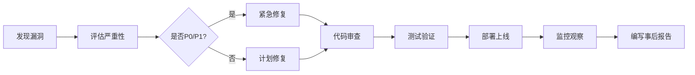

# RMFOOD 安全最佳实践指南

## 📋 目录
1. [依赖安全管理](#依赖安全管理)
2. [代码安全规范](#代码安全规范)
3. [配置安全要求](#配置安全要求)
4. [定期安全审计](#定期安全审计)
5. [应急响应流程](#应急响应流程)

---

## 依赖安全管理

### 1. 定期更新依赖

```bash
# 检查过时的包
pip list --outdated --format=columns

# 批量升级（谨慎使用）
pip install --upgrade -r requirements.txt

# 使用 pip-tools 锁定版本（推荐）
pip-compile requirements.in
```

### 2. 安全扫描工具使用

#### pip-audit (PyPA官方推荐)

```bash
# 安装
pip install pip-audit

# 扫描当前环境
pip audit

# 基于requirements.txt扫描
pip audit -r requirements.txt

# 输出JSON格式（适合CI/CD）
pip audit -r requirements.txt --format json

# 排除特定漏洞（临时措施）
pip audit --skip 123456,789012
```

#### safety (备选方案)

```bash
# 安装
pip install safety

# 在线扫描（需要网络）
safety check -r requirements.txt

# 离线扫描（使用本地数据库）
safety db download
safety check -r requirements.txt --database safety.db
```

#### bandit (代码静态分析)

```bash
# 安装
pip install bandit

# 扫描整个项目
bandit -r ./app/

# 排除测试目录
bandit -r ./app/ -x tests,migrations

# 只显示高/中危问题
bandit -r ./app/ -ll

# 输出JSON格式
bandit -r ./app/ -f json -o report.json

# 配置文件 (.bandit)
[bandit]
exclude: /tests,/migrations,/alembic
tests: B101,B102
```

---

## 代码安全规范

### 1. 密码和密钥管理

```python
# ✅ 正确：从环境变量读取
from pydantic_settings import BaseSettings

class Settings(BaseSettings):
    secret_key: str  # 必须从环境变量获取
    
    class Config:
        env_file = ".env"

# ❌ 错误：硬编码密钥
SECRET_KEY = "my-secret-key-12345"  # 永远不要这样做！
```

### 2. SQL注入防护

```python
# ✅ 正确：使用参数化查询
from sqlalchemy import text

query = text("SELECT * FROM users WHERE id = :user_id")
result = await db.execute(query, {"user_id": user_id})

# ❌ 错误：字符串拼接
query = f"SELECT * FROM users WHERE id = {user_id}"  # 危险！
```

### 3. XSS防护

```python
# ✅ 正确：使用模板引擎自动转义
from fastapi import FastAPI
from fastapi.templating import Jinja2Templates

templates = Jinja2Templates(directory="templates")

@app.get("/")
async def home(request: Request):
    return templates.TemplateResponse("index.html", {"request": request})
```

### 4. CSRF保护

```python
# FastAPI 自动处理CSRF（如果使用Cookie认证）
# 对于API，建议使用JWT + Bearer Token
```

---

## 配置安全要求

### 生产环境必须项 (P0)

| 配置项 | 要求 | 示例 |
|--------|------|------|
| `DEBUG` | 必须为 `false` | `DEBUG=false` |
| `SECRET_KEY` | ≥32字符的强随机值 | 使用 `secrets.token_urlsafe(48)` |
| `ADMIN_PASSWORD` | ≥12位，包含大小写+数字+特殊字符 | `MyP@ssw0rd2024!` |
| `DATABASE_URL` | 使用PostgreSQL（非SQLite） | `postgresql://...` |
| `CORS_ORIGINS` | 明确指定允许的域名 | `https://example.com` |

### 推荐配置 (P1)

```bash
# .env.production

# 强制HTTPS
FORCE_HTTPS=true

# 会话安全
SESSION_COOKIE_SECURE=true
SESSION_COOKIE_HTTPONLY=true
SESSION_COOKIE_SAMESITE=Strict

# 文件上传限制
MAX_UPLOAD_SIZE_MB=10
ALLOWED_EXTENSIONS=.pdf,.doc,.docx,.png,.jpg,.jpeg

# 日志级别
LOG_LEVEL=INFO  # 生产环境不要用 DEBUG

# 账号安全
MAX_LOGIN_ATTEMPTS=5
LOCKOUT_DURATION_MINUTES=15
```

---

## 定期安全审计

### 审计周期

| 审计类型 | 频率 | 负责人 |
|----------|------|--------|
| 依赖漏洞扫描 | 每周 | 开发团队 |
| 代码安全分析 | 每次发布前 | 安全工程师 |
| 配置审查 | 每月 | DevOps团队 |
| 渗透测试 | 每季度 | 外部安全公司 |
| 应急演练 | 半年一次 | 全员参与 |

### CI/CD集成示例

```yaml
# .github/workflows/security.yml
name: Security Scan

on:
  push:
    branches: [main]
  pull_request:
    branches: [main]

jobs:
  security:
    runs-on: ubuntu-latest
    
    steps:
      - uses: actions/checkout@v3
      
      - name: Set up Python
        uses: actions/setup-python@v4
        with:
          python-version: '3.11'
      
      - name: Install dependencies
        run: |
          pip install -r requirements.txt
          pip install pip-audit bandit safety
      
      - name: Run pip-audit
        run: pip audit -r requirements.txt || true
      
      - name: Run bandit
        run: bandit -r app/ -ll || true
      
      - name: Run safety
        run: safety check -r requirements.txt || true
      
      - name: Upload security report
        if: always()
        uses: actions/upload-artifact@v3
        with:
          name: security-report
          path: report.*
```

---

## 应急响应流程

### 1. 发现安全漏洞

**立即行动**：
1. 🔒 **隔离受影响系统**
2. 📝 **记录漏洞详情**（时间、影响范围、复现步骤）
3. 👥 **通知安全团队**

**联系方式**：
- 安全团队邮箱: security@rmfood.com
- 紧急电话: [内部通讯录]
- Slack频道: #security-alerts

### 2. 漏洞分级与响应时间

| 级别 | 描述 | 响应时间 | 修复时间 |
|------|------|----------|----------|
| 🔴 P0-Critical | RCE、数据泄露、权限提升 | 1小时 | 24小时内 |
| 🟠 P1-High | XSS、SQL注入、认证绕过 | 4小时 | 7天内 |
| 🟡 P2-Medium | 信息泄露、配置错误 | 24小时 | 14天内 |
| 🟢 P3-Low | 最佳实践改进 | 72小时 | 30天内 |

### 3. 修复与验证流程



### 4. 事后复盘

**必须在修复后48小时内完成**：

1. **根本原因分析**（5 Whys方法）
2. **影响范围评估**
3. **预防措施制定**
4. **流程改进建议**
5. **知识库更新**

---

## 📚 参考资源

### 官方文档
- [OWASP Top 10](https://owasp.org/www-project-top-ten/)
- [CWE/SANS Top 25](https://cwe.mitre.org/top25/archive/)
- [Python安全编码指南](https://python-security.readthedocs.io/)

### 工具链接
- [pip-audit GitHub](https://github.com/trailofbits/pip-audit)
- [bandit GitHub](https://github.com/PyCQA/bandit)
- [safety CLI](https://pyup.io/safety/)
- [Snyk (商业)](https://snyk.io/)

### 学习资源
- [PortSwigger Web Academy](https://portswigger.net/web-security)
- [HackTheBox](https://www.hackthebox.com/)
- [TryHackMe](https://tryhackme.com/)

---

**最后更新**: 2026-05-02  
**维护者**: RMFOOD 安全团队  
**版本**: 1.0.0