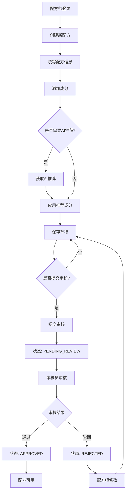
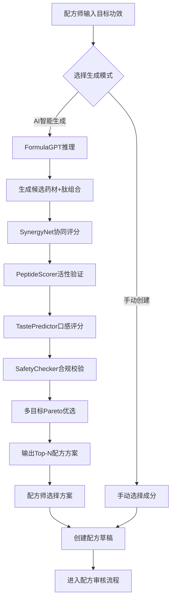
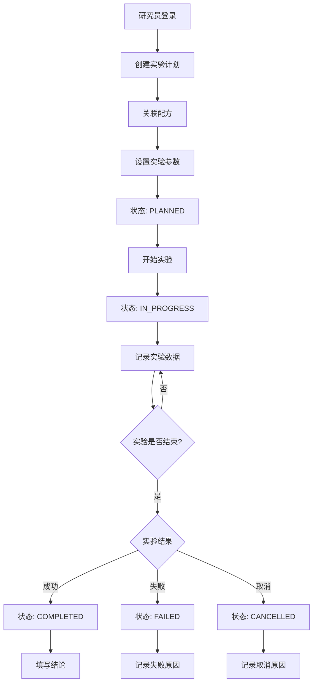

# RMFOOD配方制作平台 - 项目方案文档

## 一、项目概述

### 1.1 项目背景
RMFOOD配方制作平台是为莱茵（厦门）分子生物科技有限公司专业开发的配方数据管理与研发协作平台。平台旨在实现配方数据的数字化管理、研发流程的规范化、实验数据的可追溯性，以及AI辅助配方推荐等核心功能。

平台深度整合两大核心科研数据库：
- **TCMSP中药系统药理学数据库** (tcmsp-e.com)：收录502种中药材、13,144个化学成分、3,311个靶点、837种疾病关联，为药食同源原料筛选提供药理学依据。
- **DFBP食源性生物活性肽数据库** (cqudfbp.net)：收录7,058条活性肽条目（v2.x在线版本）、21,249条食源性蛋白质、31种活性类型，为功能性肽原料的定向筛选提供数据支撑。

> **数据版本说明**：DFBP原始论文（Qin et al., *Bioinformatics*, 2022）报告6,276条肽条目（v1.0论文快照），当前在线数据库已迭代至7,058条（v2.x），经Liu et al.（*aBIOTECH*, 2026）引用确认。两版本差异源于数据库持续更新，非统计错误。平台开发对接在线活跃版本。

### 1.2 技术栈选型

| 层级 | 技术选型 | 版本 | 说明 |
|------|----------|------|------|
| **前端框架** | Next.js | 15.0.0 | React全栈框架，支持SSR/SSG |
| **UI库** | React | 18.2.0 | 声明式UI组件库 |
| **状态管理** | Zustand | 4.5.0 | 轻量级状态管理 |
| **数据请求** | Axios | 1.6.5 | HTTP客户端 |
| **样式方案** | Tailwind CSS | 3.4.1 | 原子化CSS框架 |
| **图表库** | ECharts | 5.5.0 | 数据可视化 |
| **后端框架** | FastAPI | 0.110.0+ | 高性能异步Python Web框架 |
| **ORM** | SQLAlchemy | 2.0.25+ | 异步ORM框架 |
| **数据库** | SQLite (开发) / PostgreSQL (生产) | - | 关系型数据库 |
| **认证方案** | JWT + bcrypt | - | 安全认证机制 |
| **AI集成** | OpenAI API | 1.12.0+ | AI配方推荐服务（基础） |
| **AI推理引擎** | PyTorch + vLLM | 2.2+ / 0.4+ | 多模型并行推理，LoRA热切换 |
| **图数据库** | Neo4j | 5.x | 药材-成分-靶点-肽多维关联知识图谱 |
| **搜索引擎** | ElasticSearch | 8.x | 肽序列模糊搜索，BM25+向量混合检索 |
| **缓存** | Redis Cluster | 7.x | 高频配方模板缓存，Session管理 |
| **任务队列** | Celery + RabbitMQ | 5.3+ / 3.12+ | 长时间配方优化任务异步化处理 |
| **API网关** | Kong Gateway | 3.x | 限流、认证、日志、灰度发布 |
| **容器编排** | Kubernetes (EKS) | 1.28+ | GPU节点池弹性伸缩，AI推理与Web服务隔离 |

### 1.3 系统架构图

```
┌──────────────────────────────────────────────────────────────────────────────┐
│                          接口层 · API Gateway                                │
│  ┌──────────────┐  ┌──────────────┐  ┌──────────────┐  ┌──────────────┐     │
│  │ RESTful API  │  │ GraphQL端点  │  │  WebSocket   │  │  SDK / CLI   │     │
│  │ JWT认证,限流  │  │ 药材-肽关联  │  │ AI推理流式   │  │ 批量配方脚本 │     │
│  └──────────────┘  └──────────────┘  └──────────────┘  └──────────────┘     │
│  ┌────────────────────────────────────────────────────────────────────┐      │
│  │                    Kong API Gateway (限流/认证/灰度)                │      │
│  └────────────────────────────────────────────────────────────────────┘      │
└──────────────────────────────────────────────────────────────────────────────┘
                                    │
                                    ▼
┌──────────────────────────────────────────────────────────────────────────────┐
│                          客户端层 · Frontend (Next.js 15)                     │
│  ┌───────────┐ ┌───────────┐ ┌───────────┐ ┌───────────┐ ┌───────────┐     │
│  │  登录页   │ │  仪表盘   │ │ 配方管理  │ │ 实验管理  │ │ AI助手面板│     │
│  └───────────┘ └───────────┘ └───────────┘ └───────────┘ └───────────┘     │
│  ┌────────────────────────────────────────────────────────────────────┐      │
│  │              Zustand状态管理 + Axios API客户端                      │      │
│  └────────────────────────────────────────────────────────────────────┘      │
└──────────────────────────────────────────────────────────────────────────────┘
                                    │
                                    │ HTTP/REST + WebSocket
                                    ▼
┌──────────────────────────────────────────────────────────────────────────────┐
│                          应用层 · Backend (FastAPI)                            │
│  ┌────────────────────────────────────────────────────────────────────┐      │
│  │                    FastAPI 应用入口 (main.py)                       │      │
│  └────────────────────────────────────────────────────────────────────┘      │
│  ┌───────────┐ ┌───────────┐ ┌───────────┐ ┌───────────┐ ┌───────────┐     │
│  │ 认证路由  │ │ 配方路由  │ │ 实验路由  │ │ 用户路由  │ │ AI路由    │     │
│  │ /auth     │ │ /formulas │ │/experiments│ │ /users    │ │ /ai       │     │
│  └───────────┘ └───────────┘ └───────────┘ └───────────┘ └───────────┘     │
│  ┌────────────────────────────────────────────────────────────────────┐      │
│  │    业务服务层: AuthService / FormulaService / ExperimentService     │      │
│  │    AI服务层:  FormulaGPT / SynergyNet / PeptideScorer / SafetyChk │      │
│  └────────────────────────────────────────────────────────────────────┘      │
│  ┌───────────────────────────┐  ┌────────────────────────────────────┐      │
│  │ 数据模型层 (SQLAlchemy)    │  │ AI推理引擎 (PyTorch + vLLM)       │      │
│  │ User/Formula/Experiment   │  │ Celery异步任务队列 + RabbitMQ      │      │
│  └───────────────────────────┘  └────────────────────────────────────┘      │
└──────────────────────────────────────────────────────────────────────────────┘
                                    │
                                    │ SQLAlchemy ORM / Py2neo / ES Client
                                    ▼
┌──────────────────────────────────────────────────────────────────────────────┐
│                          数据层 · Database                                    │
│  ┌──────────────┐  ┌──────────────┐  ┌──────────────┐  ┌──────────────┐     │
│  │ PostgreSQL   │  │   Neo4j 5.x  │  │ElasticSearch │  │ Redis 7      │     │
│  │ 业务数据主库  │  │ 知识图谱     │  │ 肽序列搜索   │  │ 缓存/Session │     │
│  │ (SQLite开发)  │  │ 药材-靶点-肽 │  │ BM25+向量    │  │ 配方模板     │     │
│  └──────────────┘  └──────────────┘  └──────────────┘  └──────────────┘     │
│  ┌──────────────────────────────────┐  ┌─────────────────────────────┐      │
│  │ TCMSP数据仓库                    │  │ DFBP数据仓库                 │      │
│  │ 502种中药/13,144成分/3,311靶点   │  │ 7,058肽条目/21,249蛋白质     │      │
│  └──────────────────────────────────┘  └─────────────────────────────┘      │
└──────────────────────────────────────────────────────────────────────────────┘
```

---

## 二、项目目录结构

### 2.1 整体目录结构

```
h:\中药和多肽数据库配方平台\
├── backend/                    # 后端项目
│   ├── app/                    # 应用主目录
│   │   ├── api/                # API路由层
│   │   ├── core/               # 核心配置
│   │   ├── models/             # 数据模型
│   │   ├── schemas/            # 数据模式
│   │   ├── services/           # 业务服务
│   │   ├── __init__.py
│   │   └── main.py             # 应用入口
│   ├── requirements.txt        # Python依赖
│   ├── Dockerfile              # Docker配置
│   ├── .env.example            # 环境变量示例
│   └── rmfood.db               # SQLite数据库文件
│
├── frontend/                   # 前端项目
│   ├── src/                    # 源代码目录
│   │   ├── app/                # Next.js页面路由
│   │   ├── components/         # React组件
│   │   ├── lib/                # 工具库
│   │   └── types/              # TypeScript类型
│   ├── public/                 # 静态资源
│   ├── package.json            # Node.js依赖
│   ├── tailwind.config.ts      # Tailwind配置
│   ├── tsconfig.json           # TypeScript配置
│   └── next.config.js          # Next.js配置
│
└── 平台方案思路/               # 设计文档目录
    └── platform-report_*.html  # 原始设计文档
```

### 2.2 后端目录详细说明

```
backend/
├── app/
│   ├── __init__.py             # 应用包初始化
│   ├── main.py                 # FastAPI应用入口
│   │                           # - 创建FastAPI实例
│   │                           # - 配置CORS中间件
│   │                           # - 注册API路由
│   │                           # - 生命周期管理
│   │
│   ├── api/                    # API路由层
│   │   ├── __init__.py         # 路由聚合 (api_router)
│   │   ├── auth.py             # 认证相关API
│   │   │                       # - POST /auth/register  用户注册
│   │   │                       # - POST /auth/login     用户登录
│   │   │                       # - GET  /auth/me        获取当前用户
│   │   │                       # - PUT  /auth/me        更新用户信息
│   │   │                       # - POST /auth/change-password  修改密码
│   │   │                       # - POST /auth/refresh   刷新令牌
│   │   ├── formulas.py         # 配方管理API
│   │   │                       # - GET    /formulas         配方列表
│   │   │                       # - POST   /formulas         创建配方
│   │   │                       # - GET    /formulas/{id}    配方详情
│   │   │                       # - PUT    /formulas/{id}    更新配方
│   │   │                       # - DELETE /formulas/{id}    删除配方
│   │   │                       # - POST   /formulas/{id}/submit   提交审核
│   │   │                       # - POST   /formulas/{id}/review   审核配方
│   │   │                       # - GET    /formulas/{id}/versions 版本历史
│   │   │                       # - POST   /formulas/ai-recommend  AI推荐
│   │   │                       # - POST   /formulas/ai-generate   AI智能生成(FormulaGPT)
│   │   │                       # - POST   /formulas/{id}/synergy  协同作用分析(SynergyNet)
│   │   │                       # - POST   /formulas/{id}/safety   安全合规校验(SafetyChecker)
│   │   ├── experiments.py      # 实验管理API
│   │   │                       # - GET    /experiments       实验列表
│   │   │                       # - POST   /experiments       创建实验
│   │   │                       # - GET    /experiments/{id}  实验详情
│   │   │                       # - PUT    /experiments/{id}  更新实验
│   │   │                       # - DELETE /experiments/{id}  删除实验
│   │   │                       # - POST   /experiments/{id}/status 更新状态
│   │   │                       # - POST   /experiments/{id}/data   添加数据
│   │   │                       # - GET    /experiments/{id}/data   获取数据
│   │   └── users.py            # 用户管理API
│   │                           # - GET  /users              用户列表
│   │                           # - GET  /users/{id}         用户详情
│   │                           # - PUT  /users/{id}/role    更新角色
│   │                           # - PUT  /users/{id}/activate   激活用户
│   │                           # - PUT  /users/{id}/deactivate 禁用用户
│   │                           # - GET  /users/stats/overview  统计概览
│   │   ├── ai.py               # AI智能服务API
│   │   │                       # - POST /ai/generate        FormulaGPT配方生成
│   │   │                       # - POST /ai/synergy         SynergyNet协同分析
│   │   │                       # - POST /ai/peptide-score   PeptideScorer活性预测
│   │   │                       # - POST /ai/taste-predict   TastePredictor口感预测
│   │   │                       # - POST /ai/stability       StabilityModel稳定性预测
│   │   │                       # - POST /ai/safety-check    SafetyChecker安全筛查
│   │   │                       # - GET  /ai/models/status   模型运行状态
│   │   └── databases.py        # 数据库检索API
│   │                           # - GET  /db/tcmsp/herbs     TCMSP药材检索
│   │                           # - GET  /db/tcmsp/compounds 化学成分检索
│   │                           # - GET  /db/dfbp/peptides   DFBP活性肽检索
│   │                           # - GET  /db/dfbp/proteins   食源蛋白检索
│   │                           # - POST /db/search          自然语言智能检索
│   │                           # - GET  /db/graph/explore   知识图谱探索
│   │
│   ├── core/                   # 核心配置模块
│   │   ├── config.py           # 应用配置
│   │   │                       # - APP_NAME/VERSION/DESCRIPTION
│   │   │                       # - DATABASE_URL 数据库连接
│   │   │                       # - SECRET_KEY/JWT配置
│   │   │                       # - CORS_ORIGINS 跨域配置
│   │   │                       # - OPENAI_API_KEY AI配置
│   │   │                       # - NEO4J_URI/NEO4J_AUTH Neo4j连接
│   │   │                       # - ELASTICSEARCH_URL ES连接
│   │   │                       # - REDIS_URL Redis连接
│   │   │                       # - CELERY_BROKER_URL 任务队列
│   │   │                       # - VLLM_ENDPOINT AI推理端点
│   │   ├── database.py         # 数据库基类定义（PostgreSQL + Neo4j + ES）
│     ├── session.py            # 数据库会话管理
│   │                           # - get_db() 依赖注入
│   │                           # - 异步引擎配置
│   │   └── init_db.py          # 数据库初始化脚本
│   │
│   ├── models/                 # 数据模型层 (ORM)
│   │   ├── __init__.py
│   │   └── models.py           # SQLAlchemy模型定义
│   │                           # - UserRole (枚举: guest/researcher/formulator/reviewer/admin)
│   │                           # - FormulaStatus (枚举: draft/pending_review/approved/rejected/archived)
│   │                           # - ExperimentStatus (枚举: planned/in_progress/completed/failed/cancelled)
│   │                           # - User 用户模型
│   │                           # - Formula 配方模型
│   │                           # - FormulaVersion 配方版本模型
│   │                           # - Ingredient 成分模型
│   │                           # - Peptide 多肽模型
│   │                           # - Experiment 实验模型
│   │                           # - ExperimentData 实验数据模型
│   │                           # - Workflow 工作流模型
│   │                           # - WorkflowTask 工作流任务模型
│   │                           # - Attachment 附件模型
│   │                           # - AuditLog 审计日志模型
│   │
│   ├── schemas/                # Pydantic数据模式
│   │   ├── __init__.py         # 模式导出
│   │   ├── user.py             # 用户相关模式
│   │   │                       # - UserBase / UserCreate / UserUpdate / UserResponse
│   │   │                       # - Token / TokenPayload / LoginRequest / PasswordChange
│   │   ├── formula.py          # 配方相关模式
│   │   │                       # - FormulaBase / FormulaCreate / FormulaUpdate / FormulaResponse
│   │   │                       # - FormulaListResponse / FormulaVersionResponse
│   │   │                       # - AIRecommendationRequest / AIRecommendationResponse
│   │   └── experiment.py       # 实验相关模式
│   │                           # - ExperimentBase / ExperimentCreate / ExperimentUpdate
│   │                           # - ExperimentResponse / ExperimentListResponse
│   │                           # - ExperimentDataBase / ExperimentDataResponse
│   │
│   └── services/               # 业务服务层
│       ├── __init__.py         # 服务导出
│       ├── auth.py             # 认证服务
│       │                       # - verify_password() 密码验证
│       │                       # - get_password_hash() 密码哈希
│       │                       # - create_access_token() 创建访问令牌
│       │                       # - create_refresh_token() 创建刷新令牌
│       │                       # - decode_token() 解码令牌
│       │                       # - get_current_user() 获取当前用户
│       │                       # - check_permission() 权限检查
│       ├── formula.py          # 配方服务
│       │                       # - FormulaService.create() 创建配方
│       │                       # - FormulaService.get_by_id() 获取配方
│       │                       # - FormulaService.get_list() 配方列表
│       │                       # - FormulaService.update() 更新配方
│       │                       # - FormulaService.delete() 删除配方
│       │                       # - FormulaService.submit_for_review() 提交审核
│       │                       # - FormulaService.review() 审核配方
│       │                       # - FormulaService.get_versions() 获取版本
│       ├── experiment.py       # 实验服务
│       │                       # - ExperimentService.create() 创建实验
│       │                       # - ExperimentService.get_by_id() 获取实验
│       │                       # - ExperimentService.get_list() 实验列表
│       │                       # - ExperimentService.update() 更新实验
│       │                       # - ExperimentService.delete() 删除实验
│       │                       # - ExperimentService.update_status() 更新状态
│       │                       # - ExperimentService.add_data_point() 添加数据
│       │                       # - ExperimentService.get_data_points() 获取数据
│       └── ai.py               # AI服务
│                               # - AIFormulaService 配方AI推荐
│                               # - ai_service 全局AI服务实例
│       ├── ai_models/          # AI模型服务层
│       │   ├── __init__.py
│       │   ├── formula_gpt.py  # FormulaGPT服务
│       │   │                   # - LLaMA-3 70B LoRA微调推理
│       │   │                   # - 配方生成与多目标优化
│       │   │                   # - 君臣佐使配伍逻辑编排
│       │   ├── synergy_net.py  # SynergyNet服务
│       │   │                   # - GNN+Transformer协同预测
│       │   │                   # - 药材-肽交互评分
│       │   │                   # - 拮抗预警与配伍禁忌
│       │   ├── peptide_scorer.py # PeptideScorer服务
│       │   │                   # - ESM-2蛋白语言模型
│       │   │                   # - 活性肽活性预测(Pearson r≥0.89)
│       │   ├── taste_predictor.py # TastePredictor服务
│       │   │                   # - XGBoost+分子描述符
│       │   │                   # - 甜度/苦味/涩味综合预测
│       │   ├── stability_model.py # StabilityModel服务
│       │   │                   # - LSTM+Attention时序预测
│       │   │                   # - 12月稳定性曲线建模
│       │   └── safety_checker.py # SafetyChecker服务
│       │                       # - Random Forest+规则引擎
│       │                       # - 药食同源目录校验
│       │                       # - 毒性/过敏原/重金属筛查(召回率≥99.5%)
│       ├── data_sources/       # 外部数据源集成层
│       │   ├── __init__.py
│       │   ├── tcmsp_client.py # TCMSP数据对接
│       │   │                   # - 官方API+授权批量导出（季度同步）
│       │   │                   # - 502种中药材结构化数据
│       │   ├── dfbp_client.py  # DFBP数据对接
│       │   │                   # - 官方API+增量同步（月度）
│       │   │                   # - 7,058肽条目+21,249蛋白质
│       │   ├── graph_service.py # Neo4j知识图谱服务
│       │   │                   # - 药材→成分→靶点←肽→蛋白→食物源
│       │   │                   # - 跨库关联图谱构建与查询
│       │   └── search_service.py # ElasticSearch检索服务
│       │                       # - 肽序列模糊搜索(BLAST/Smith-Waterman)
│       │                       # - BM25+向量混合检索
│       └── tasks/              # Celery异步任务
│           ├── __init__.py
│           ├── formula_tasks.py  # 配方生成异步任务
│           ├── data_sync.py      # 数据同步定时任务
│           └── report_tasks.py   # 报告生成异步任务
│
├── requirements.txt            # Python依赖清单
├── Dockerfile                  # Docker构建文件
├── .env.example                # 环境变量示例
└── rmfood.db                   # SQLite数据库文件
```

### 2.3 前端目录详细说明

```
frontend/
├── src/
│   ├── app/                    # Next.js App Router页面
│   │   ├── layout.tsx          # 根布局组件
│   │   │                       # - 配置字体 (Noto Sans/Serif SC, JetBrains Mono)
│   │   │                       # - 设置HTML元数据
│   │   ├── page.tsx            # 首页 (重定向到登录页)
│   │   ├── globals.css         # 全局样式
│   │   │                       # - CSS变量定义
│   │   │                       # - Tailwind组件类
│   │   │                       # - 滚动条样式
│   │   ├── login/
│   │   │   └── page.tsx        # 登录页面
│   │   │                       # - 登录表单
│   │   │                       # - 注册表单
│   │   │                       # - Token存储管理
│   │   ├── dashboard/
│   │   │   └── page.tsx        # 仪表盘页面
│   │   │                       # - 统计卡片展示
│   │   │                       # - 待审核配方列表
│   │   │                       # - 近期实验列表
│   │   │                       # - 快速操作入口
│   │   ├── formulas/
│   │   │   └── page.tsx        # 配方管理页面
│   │   │                       # - 配方列表
│   │   │                       # - 配方搜索
│   │   │                       # - 配方创建/编辑
│   │   └── experiments/
│   │       └── page.tsx        # 实验管理页面
│   │                           # - 实验列表
│   │                           # - 实验搜索
│   │                           # - 实验创建/编辑
│   │   ├── ai/
│   │   │   └── page.tsx        # AI智能助手面板
│   │   │                       # - FormulaGPT配方生成界面
│   │   │                       # - 协同分析可视化
│   │   │                       # - 安全合规校验结果
│   │   │                       # - 对话式AI助手(ChatBot)
│   │   └── databases/
│   │       └── page.tsx        # 数据库检索页面
│   │                           # - TCMSP药材检索
│   │                           # - DFBP活性肽检索
│   │                           # - 知识图谱可视化探索
│   │                           # - 自然语言智能搜索
│   │
│   ├── components/             # React组件库
│   │   ├── layout/             # 布局组件
│   │   │   ├── index.ts        # 导出文件
│   │   │   ├── DashboardLayout.tsx  # 仪表盘布局
│   │   │   │                       # - 认证检查
│   │   │   │                       # - 侧边栏+头部+主内容区
│   │   │   ├── Sidebar.tsx     # 侧边栏组件
│   │   │   │                       # - 导航菜单
│   │   │   │                       # - 用户信息显示
│   │   │   │                       # - 退出登录
│   │   │   └── Header.tsx      # 头部组件
│   │   │                           # - 面包屑导航
│   │   │                           # - 用户菜单
│   │   │                           # - 通知入口
│   │   └── ui/                 # UI基础组件
│   │       ├── index.ts        # 导出文件
│   │       ├── Button.tsx      # 按钮组件
│   │       │                       # - variant: primary/secondary/outline/ghost
│   │       │                       # - size: sm/md/lg
│   │       ├── Input.tsx       # 输入框组件
│   │       │                       # - 支持前缀/后缀图标
│   │       │                       # - 错误状态显示
│   │       └── Select.tsx      # 选择器组件
│   │                               # - 下拉选项
│   │                               # - 搜索过滤
│   │
│   ├── lib/                    # 工具库
│   │   ├── api.ts              # API客户端
│   │   │                       # - apiClient: Axios实例配置
│   │   │                       # - 请求拦截器: 自动添加Token
│   │   │                       # - 响应拦截器: 401自动跳转登录
│   │   │                       # - authApi: 认证相关API
│   │   │                       # - formulaApi: 配方相关API
│   │   │                       # - experimentApi: 实验相关API
│   │   │                       # - userApi: 用户相关API
│   │   │                       # - aiApi: AI智能服务API
│   │   │                       # - dbApi: 数据库检索API
│   │   ├── store.ts            # 状态管理
│   │   │                       # - useAuthStore: 认证状态
│   │   │                       #   (user, token, isAuthenticated, setUser, setToken, logout)
│   │   │                       # - useUIStore: UI状态
│   │   │                       #   (sidebarOpen, theme, toggleSidebar, setTheme)
│   │   └── utils.ts            # 工具函数
│   │                               # - cn(): 类名合并 (clsx + tailwind-merge)
│   │                               # - getRoleText(): 角色文本转换
│   │                               # - formatDate(): 日期格式化
│   │
│   └── types/                  # TypeScript类型定义
│       └── index.ts            # 全局类型
│                               # - User / UserRole
│                               # - Token / LoginRequest
│                               # - Formula / FormulaStatus / IngredientItem
│                               # - Experiment / ExperimentStatus / ExperimentData
│                               # - PaginatedResponse / ApiResponse
│
├── public/                     # 静态资源目录
├── package.json                # 项目配置与依赖
├── tailwind.config.ts          # Tailwind配置
│                               # - 自定义颜色 (primary/secondary/accent/dark)
│                               # - 自定义字体
├── tsconfig.json               # TypeScript配置
├── next.config.js              # Next.js配置
└── postcss.config.js           # PostCSS配置
```

---

## 三、功能模块说明

### 3.1 用户认证模块 (Authentication)

**职责**：处理用户注册、登录、令牌管理和权限控制

**核心功能**：
- 用户注册：新用户账号创建，默认角色为 RESEARCHER
- 用户登录：用户名/密码验证，生成JWT令牌
- 令牌刷新：Access Token过期后使用Refresh Token刷新
- 密码修改：验证旧密码后更新新密码
- 权限控制：基于角色的访问控制 (RBAC)

**角色权限层级**：
```
GUEST (访客)        → 权限等级 0
RESEARCHER (研究员) → 权限等级 1  [可创建/管理实验]
FORMULATOR (配方师) → 权限等级 2  [可创建/管理配方]
REVIEWER (审核员)   → 权限等级 3  [可审核配方]
ADMIN (管理员)      → 权限等级 4  [全部权限]
```

**API端点**：
| 方法 | 路径 | 权限 | 说明 |
|------|------|------|------|
| POST | /auth/register | 公开 | 用户注册 |
| POST | /auth/login | 公开 | 用户登录 |
| GET | /auth/me | 登录用户 | 获取当前用户信息 |
| PUT | /auth/me | 登录用户 | 更新用户信息 |
| POST | /auth/change-password | 登录用户 | 修改密码 |
| POST | /auth/refresh | 登录用户 | 刷新令牌 |

### 3.2 配方管理模块 (Formula Management)

**职责**：管理配方的完整生命周期，包括创建、编辑、审核、版本控制

**核心功能**：
- 配方CRUD：创建、读取、更新、删除配方
- 配方搜索：按关键词、状态、功效、创建者筛选
- 审核流程：提交审核 → 审核员审批 → 通过/驳回
- 版本管理：每次修改自动创建版本快照
- AI推荐：基于目标功效推荐成分组合

**配方状态流转**：
```
DRAFT (草稿)
    │
    ▼ [提交审核]
PENDING_REVIEW (待审核)
    │
    ├─[审核通过]→ APPROVED (已批准)
    │
    └─[审核驳回]→ REJECTED (已驳回)
                      │
                      ▼ [重新编辑]
                   DRAFT (草稿)
```

**API端点**：
| 方法 | 路径 | 权限 | 说明 |
|------|------|------|------|
| GET | /formulas | 登录用户 | 配方列表 |
| POST | /formulas | FORMULATOR+ | 创建配方 |
| GET | /formulas/{id} | 登录用户 | 配方详情 |
| PUT | /formulas/{id} | FORMULATOR+ | 更新配方 |
| DELETE | /formulas/{id} | ADMIN | 删除配方 |
| POST | /formulas/{id}/submit | FORMULATOR+ | 提交审核 |
| POST | /formulas/{id}/review | REVIEWER+ | 审核配方 |
| GET | /formulas/{id}/versions | 登录用户 | 版本历史 |
| POST | /formulas/ai-recommend | 登录用户 | AI推荐 |

### 3.3 实验管理模块 (Experiment Management)

**职责**：管理实验计划、执行过程和数据记录

**核心功能**：
- 实验CRUD：创建、读取、更新、删除实验
- 实验搜索：按关键词、状态、配方、研究员筛选
- 状态管理：实验进度状态更新
- 数据记录：实验过程中采集的数据点记录
- 关联配方：实验可关联特定配方

**实验状态流转**：
```
PLANNED (计划中)
    │
    ▼ [开始实验]
IN_PROGRESS (进行中)
    │
    ├─[实验完成]→ COMPLETED (已完成)
    │
    ├─[实验失败]→ FAILED (失败)
    │
    └─[取消实验]→ CANCELLED (已取消)
```

**API端点**：
| 方法 | 路径 | 权限 | 说明 |
|------|------|------|------|
| GET | /experiments | 登录用户 | 实验列表 |
| POST | /experiments | RESEARCHER+ | 创建实验 |
| GET | /experiments/{id} | 登录用户 | 实验详情 |
| PUT | /experiments/{id} | RESEARCHER+ | 更新实验 |
| DELETE | /experiments/{id} | ADMIN | 删除实验 |
| POST | /experiments/{id}/status | RESEARCHER+ | 更新状态 |
| POST | /experiments/{id}/data | RESEARCHER+ | 添加数据 |
| GET | /experiments/{id}/data | 登录用户 | 获取数据 |

### 3.4 用户管理模块 (User Management)

**职责**：管理平台用户，包括角色分配和账号状态

**核心功能**：
- 用户列表：查看所有用户
- 角色管理：更新用户角色
- 账号控制：激活/禁用用户账号
- 统计概览：平台数据统计

**API端点**：
| 方法 | 路径 | 权限 | 说明 |
|------|------|------|------|
| GET | /users | ADMIN | 用户列表 |
| GET | /users/{id} | 登录用户 | 用户详情 |
| PUT | /users/{id}/role | ADMIN | 更新角色 |
| PUT | /users/{id}/activate | ADMIN | 激活用户 |
| PUT | /users/{id}/deactivate | ADMIN | 禁用用户 |
| GET | /users/stats/overview | 登录用户 | 统计概览 |

### 3.5 AI辅助模块 (AI Assistance)

**职责**：提供AI驱动的配方智能生成、协同分析、质量预测和安全合规检查

**核心功能**：
- 成分推荐：基于目标功效推荐成分组合
- 协同分析：分析成分间的协同效应
- 安全预警：检测潜在安全风险
- 合规检查：验证配方合规性

#### 3.5.1 AI模型矩阵

| 模型名称 | 任务定位 | 模型架构 | 关键性能指标 | 部署方式 |
|----------|----------|----------|-------------|----------|
| **FormulaGPT** | 配方生成与优化 | LLaMA-3 70B LoRA微调 | BLEU≥0.82, 合规率99.2% | vLLM推理, K8s GPU Pod |
| **SynergyNet** | 协同作用预测 | GNN + Transformer | AUC≥0.91, F1≥0.87 | PyTorch Serving |
| **PeptideScorer** | 活性肽活性预测 | ESM-2 + MLP Head | Pearson r≥0.89 | ONNX Runtime |
| **TastePredictor** | 口感/苦味预测 | XGBoost + 分子描述符 | RMSE≤0.15, R²≥0.88 | Scikit-learn Serving |
| **StabilityModel** | 稳定性/保质期预测 | LSTM + Attention | MAE≤2.3% (12月) | TorchServe |
| **SafetyChecker** | 毒性/过敏原筛查 | Random Forest + 规则引擎 | 召回率≥99.5% | FastAPI内嵌 |

#### 3.5.2 FormulaGPT训练与部署流程

```
数据准备                 LoRA微调                  RLHF对齐
12,000+历史配方    →    LLaMA-3-70B基座      →    食品专家偏好标注
TCMSP+DFBP关联          rank=64, alpha=128         PPO优化
中国药典方剂库          8×A100 80GB, 72h           合规约束奖励函数
        │                      │                        │
        ▼                      ▼                        ▼
评估验证                                            生产部署
专家盲审评分≥4.2/5                              vLLM推理服务
法规合规率99.2%                                 Kubernetes GPU Pod
A/B测试胜率68%                                  P99延迟 < 8s
```

#### 3.5.3 智能配方生成流程

```
用户输入目标功效
        │
        ▼
┌──────────────────┐
│ FormulaGPT推理   │ → 生成多套药材+肽候选组合
└──────────────────┘
        │
        ├──→ SynergyNet评估 → 协同得分排序
        ├──→ PeptideScorer  → 肽活性验证
        ├──→ TastePredictor → 口感评分
        ├──→ StabilityModel → 稳定性预测
        └──→ SafetyChecker  → 合规/安全校验
                │
                ▼
        多目标Pareto优选 → 生成Top-N配方方案
                │
                ▼
        君臣佐使配伍逻辑自动编排
                │
                ▼
        输出配方报告（含可视化图表）
```

#### 3.5.4 核心AI功能详述

**智能配方生成**：
- 输入目标功效 → AI自动推荐药材+肽组合
- 多目标优化：功效/口感/成本/法规四维平衡
- 君臣佐使配伍逻辑自动编排
- 实时法规合规校验（药食同源目录+GB标准）
- 一键生成多套备选方案，支持对比评分

**数据库智能检索**：
- 自然语言查询（如："找到能降血压的乳源肽"）
- 肽序列相似性搜索（BLAST/Smith-Waterman）
- 药材-靶点-肽三角关联发现
- 多条件组合筛选（来源/活性/IC₅₀/分子量）
- 知识图谱可视化探索

**协同作用分析**：
- SynergyNet实时预测中药-肽协同评分
- 分子靶点共有通路分析（KEGG/GO富集）
- 协同热力图/网络图自动生成
- 拮抗作用/配伍禁忌自动预警
- Loewe/Bliss模型定量协同评估

**质量属性预测**：
- 溶解度预测模型（基于成分理化性质）
- 口感评分：甜度/苦味/涩味综合预测
- 色泽/气味感官模拟
- 加速稳定性试验虚拟仿真（12月曲线）
- 生物利用度PBPK模型预测

**安全合规引擎**：
- 药食同源目录实时比对（109种+动态更新）
- 添加剂用量GB 2760自动校验
- 重金属/微生物限量标准预检
- 过敏原自动识别与标签生成
- 毒性预测（SafetyChecker AI模型）

**API端点**：
| 方法 | 路径 | 权限 | 说明 |
|------|------|------|------|
| POST | /ai/generate | FORMULATOR+ | FormulaGPT智能配方生成 |
| POST | /ai/synergy | 登录用户 | SynergyNet协同分析 |
| POST | /ai/peptide-score | 登录用户 | PeptideScorer活性预测 |
| POST | /ai/taste-predict | 登录用户 | TastePredictor口感预测 |
| POST | /ai/stability | 登录用户 | StabilityModel稳定性预测 |
| POST | /ai/safety-check | 登录用户 | SafetyChecker安全筛查 |
| GET | /ai/models/status | ADMIN | AI模型运行状态监控 |
| POST | /formulas/ai-recommend | 登录用户 | AI推荐（基础版） |

### 3.6 数据库集成模块 (Database Integration)

**职责**：管理TCMSP与DFBP外部数据库的接入、同步与知识图谱构建

**核心功能**：
- TCMSP数据检索：药材查询、化学成分检索、靶点关联分析
- DFBP数据检索：活性肽筛选、蛋白质来源追溯、活性类型过滤
- 知识图谱探索：药材→成分→靶点←肽→蛋白→食物源跨库关联可视化
- 自然语言检索：基于向量嵌入的语义搜索
- 数据同步：定时增量同步外部数据源，版本快照管理

**数据获取策略**：

| 数据源 | 获取方式 | 同步频率 | 授权协议 |
|--------|----------|----------|----------|
| TCMSP | 官方API + 授权批量导出 | 季度 | 学术合作协议(MOU) |
| DFBP | 官方API + 增量同步 | 月度 | CC BY 4.0 + 数据使用协议 |
| 药食同源目录 | 国家卫健委官网公告 | 年度 | 公开政府数据 |
| PubMed文献 | Entrez E-utilities API | 周度 | NCBI开放访问 |
| UniProt蛋白 | REST API增量拉取 | 月度 | CC BY 4.0 |
| ChEMBL活性 | FTP批量下载 | 季度 | CC BY-SA 3.0 |

**数据标准化处理流程**：
1. **原始数据采集** — 多源异构数据通过ETL管道汇入数据湖
2. **格式统一** — 中药名称标准化至《中国药典》命名；肽序列统一为FASTA格式，IUPAC单字母编码
3. **去重与去噪** — 肽序列CD-HIT聚类（阈值95%）去冗余；中药成分InChIKey去重
4. **活性标注校验** — IC₅₀/EC₅₀单位统一（μM），实验条件标准化
5. **知识图谱构建** — 实体抽取(NER) → 关系抽取(RE) → 图谱融合 → 一致性校验
6. **版本快照** — 每次更新生成不可变快照（YYYYMMDD-vN），支持任意版本回溯

**质量控制标准**：
- 数据完整性 ≥99.5%（字段缺失率 < 0.5%）
- 数据准确性 ≥98%（交叉验证通过率）
- 数据新鲜度 < 24h（增量同步延迟上限）
- 可溯源性 100%（每条数据关联原始DOI）

**API端点**：
| 方法 | 路径 | 权限 | 说明 |
|------|------|------|------|
| GET | /db/tcmsp/herbs | 登录用户 | TCMSP药材检索 |
| GET | /db/tcmsp/compounds | 登录用户 | 化学成分检索 |
| GET | /db/dfbp/peptides | 登录用户 | DFBP活性肽检索 |
| GET | /db/dfbp/proteins | 登录用户 | 食源蛋白检索 |
| POST | /db/search | 登录用户 | 自然语言智能检索 |
| GET | /db/graph/explore | 登录用户 | 知识图谱探索 |
| GET | /db/snapshot/list | ADMIN | 数据快照版本列表 |
| POST | /db/sync/trigger | ADMIN | 手动触发数据同步 |

---

## 四、数据模型设计

### 4.1 实体关系图

```
┌─────────────┐       ┌─────────────┐       ┌─────────────┐
│    User     │       │   Formula   │       │ Experiment  │
├─────────────┤       ├─────────────┤       ├─────────────┤
│ id          │──┐    │ id          │──┐    │ id          │
│ username    │  │    │ name        │  │    │ title       │
│ email       │  │    │ code        │  │    │ code        │
│ role        │  │    │ status      │  │    │ status      │
│ ...         │  │    │ version     │  │    │ ...         │
└─────────────┘  │    │ creator_id  │◄─┘    │ formula_id  │◄──┐
      │          │    │ reviewer_id │◄──────│ researcher_id│◄─┤
      │          │    └─────────────┘       └─────────────┘  │
      │          │          │                     │          │
      │          │          │                     │          │
      │          │          ▼                     ▼          │
      │          │    ┌─────────────┐       ┌─────────────┐  │
      │          │    │FormulaVersion│      │ExperimentData│ │
      │          │    ├─────────────┤       ├─────────────┤  │
      │          │    │ formula_id  │       │ experiment_id│ │
      │          │    │ version     │       │ parameter   │  │
      │          │    │ snapshot    │       │ value       │  │
      │          │    └─────────────┘       └─────────────┘  │
      │          │                                           │
      │          └───────────────────────────────────────────┘
      │
      ▼
┌─────────────┐       ┌─────────────┐       ┌─────────────┐
│  AuditLog   │       │ Attachment  │       │ Ingredient  │
├─────────────┤       ├─────────────┤       ├─────────────┤
│ user_id     │       │ formula_id  │       │ name        │
│ action      │       │ experiment_id│      │ category    │
│ entity_type │       │ file_path   │       │ source      │
│ entity_id   │       │ ...         │       │ properties  │
└─────────────┘       └─────────────┘       └─────────────┘

┌─────────────┐       ┌─────────────┐       ┌─────────────┐
│  TCMHerb    │       │ BioactivePep│       │ KnowledgeNode│
├─────────────┤       ├─────────────┤       ├─────────────┤
│ name_cn     │       │ sequence    │       │ node_type   │
│ name_latin  │       │ source_prot │       │ node_id     │
│ category    │       │ activity    │       │ properties  │
│ compounds   │       │ ic50/ec50   │       │ relations   │
│ targets     │       │ mol_weight  │       │ source_db   │
│ ob_percent  │       │ source_db   │       │ version     │
│ dl_value    │       │ dfbp_version│       │ updated_at  │
└─────────────┘       └─────────────┘       └─────────────┘
```

### 4.2 核心数据表

#### User (用户表)
| 字段 | 类型 | 说明 |
|------|------|------|
| id | Integer | 主键 |
| username | String(50) | 用户名，唯一 |
| email | String(100) | 邮箱，唯一 |
| hashed_password | String(255) | 密码哈希 |
| full_name | String(100) | 全名 |
| role | Enum | 角色 (guest/researcher/formulator/reviewer/admin) |
| is_active | Boolean | 是否激活 |
| department | String(100) | 部门 |
| phone | String(20) | 电话 |
| avatar_url | String(500) | 头像URL |
| preferences | JSON | 用户偏好设置 |
| created_at | DateTime | 创建时间 |
| updated_at | DateTime | 更新时间 |

#### Formula (配方表)
| 字段 | 类型 | 说明 |
|------|------|------|
| id | Integer | 主键 |
| name | String(200) | 配方名称 |
| code | String(50) | 配方编码，唯一 |
| description | Text | 描述 |
| status | Enum | 状态 (draft/pending_review/approved/rejected/archived) |
| version | Integer | 版本号 |
| target_effects | JSON | 目标功效列表 |
| ingredients | JSON | 成分列表 |
| composition | JSON | 组成结构 |
| processing_method | Text | 加工方法 |
| dosage | String(100) | 用量 |
| storage_conditions | String(200) | 存储条件 |
| shelf_life | Integer | 保质期(天) |
| safety_check | JSON | 安全检查结果 |
| compliance_status | JSON | 合规状态 |
| ai_recommendations | JSON | AI推荐 |
| synergy_analysis | JSON | 协同分析 |
| creator_id | Integer | 创建者ID |
| reviewer_id | Integer | 审核者ID |
| reviewed_at | DateTime | 审核时间 |
| review_notes | Text | 审核备注 |
| created_at | DateTime | 创建时间 |
| updated_at | DateTime | 更新时间 |

#### Experiment (实验表)
| 字段 | 类型 | 说明 |
|------|------|------|
| id | Integer | 主键 |
| title | String(200) | 实验标题 |
| code | String(50) | 实验编码，唯一 |
| description | Text | 描述 |
| status | Enum | 状态 (planned/in_progress/completed/failed/cancelled) |
| formula_id | Integer | 关联配方ID |
| researcher_id | Integer | 研究员ID |
| objectives | JSON | 实验目标 |
| methodology | Text | 方法论 |
| parameters | JSON | 实验参数 |
| materials | JSON | 实验材料 |
| equipment | JSON | 实验设备 |
| start_date | DateTime | 计划开始日期 |
| end_date | DateTime | 计划结束日期 |
| actual_start | DateTime | 实际开始日期 |
| actual_end | DateTime | 实际结束日期 |
| results | JSON | 实验结果 |
| conclusions | Text | 结论 |
| recommendations | Text | 建议 |
| created_at | DateTime | 创建时间 |
| updated_at | DateTime | 更新时间 |

#### TCMHerb (中药材表 — TCMSP数据)
| 字段 | 类型 | 说明 |
|------|------|------|
| id | Integer | 主键 |
| name_cn | String(100) | 中文名称（标准化至《中国药典》命名） |
| name_latin | String(200) | 拉丁名 |
| name_pinyin | String(100) | 拼音名 |
| category | String(100) | 药理分类（如补气药、补阴药、利水渗湿药） |
| compounds | JSON | 主要化学成分列表 |
| targets | JSON | 靶点列表 |
| diseases | JSON | 关联疾病列表 |
| ob_percent | Float | 口服生物利用度(OB%) |
| dl_value | Float | 药物相似性(DL) |
| effects | Text | 功效特征 |
| is_food_homology | Boolean | 是否属于药食同源目录(109种) |
| tcmsp_id | String(50) | TCMSP数据库原始ID |
| source_version | String(50) | 数据来源版本 |
| synced_at | DateTime | 最近同步时间 |
| created_at | DateTime | 创建时间 |
| updated_at | DateTime | 更新时间 |

#### BioactivePeptide (生物活性肽表 — DFBP数据)
| 字段 | 类型 | 说明 |
|------|------|------|
| id | Integer | 主键 |
| sequence | String(500) | 肽序列（IUPAC单字母编码） |
| source_protein | String(200) | 来源蛋白质 |
| source_organism | String(200) | 来源生物体 |
| activity_type | String(100) | 活性类型（31种之一） |
| activity_value | Float | 活性值（IC₅₀/EC₅₀, 单位μM） |
| activity_unit | String(50) | 活性单位 |
| molecular_weight | Float | 分子量(Da) |
| hydrolysis_enzyme | String(200) | 酶解方式 |
| dfbp_id | String(50) | DFBP数据库原始ID |
| dfbp_version | String(20) | DFBP版本号（如v1.0/v2.x） |
| literature_doi | String(200) | 原始文献DOI |
| source_version | String(50) | 数据来源版本快照标识 |
| synced_at | DateTime | 最近同步时间 |
| created_at | DateTime | 创建时间 |
| updated_at | DateTime | 更新时间 |

#### KnowledgeGraphNode (知识图谱节点表 — Neo4j映射)
| 字段 | 类型 | 说明 |
|------|------|------|
| id | Integer | 主键（PostgreSQL侧同步ID） |
| neo4j_id | String(50) | Neo4j节点ID |
| node_type | Enum | 节点类型 (herb/compound/target/peptide/protein/food_source/disease) |
| node_label | String(200) | 节点标签 |
| properties | JSON | 节点属性 |
| source_db | String(50) | 来源数据库（TCMSP/DFBP/ChEMBL/UniProt） |
| version | String(50) | 版本标识 |
| created_at | DateTime | 创建时间 |
| updated_at | DateTime | 更新时间 |

#### DataSnapshot (数据快照版本表)
| 字段 | 类型 | 说明 |
|------|------|------|
| id | Integer | 主键 |
| snapshot_id | String(50) | 快照标识（YYYYMMDD-vN） |
| source_db | String(50) | 数据源标识 |
| total_records | Integer | 快照记录总数 |
| checksum | String(64) | 数据校验和(SHA-256) |
| metadata | JSON | 快照元数据（同步参数、耗时等） |
| is_active | Boolean | 是否为当前活跃版本 |
| created_at | DateTime | 快照创建时间 |

---

## 五、模块交互关系

### 5.1 前后端交互流程

```
┌──────────────────────────────────────────────────────────────────┐
│                        前端 (Next.js)                             │
│  ┌────────────┐    ┌────────────┐    ┌────────────┐              │
│  │   Page     │───▶│  Zustand   │───▶│   Axios    │              │
│  │ Component  │    │   Store    │    │   API      │              │
│  └────────────┘    └────────────┘    └────────────┘              │
│        │                 │                  │                     │
│        │                 │                  │ HTTP Request        │
│        │                 │                  │ (Bearer Token)      │
└────────│─────────────────│──────────────────│─────────────────────┘
         │                 │                  │
         │                 │                  ▼
         │                 │         ┌────────────────┐
         │                 │         │  Interceptor   │
         │                 │         │  - Add Token   │
         │                 │         │  - Handle 401  │
         │                 │         └────────────────┘
         │                 │                  │
         │                 │                  ▼
┌────────│─────────────────│─────────────────────────────────────────┐
│        │                 │               后端 (FastAPI)             │
│        │                 │          ┌────────────────┐              │
│        │                 │          │  Middleware    │              │
│        │                 │          │  - CORS        │              │
│        │                 │          └────────────────┘              │
│        │                 │                  │                       │
│        │                 │                  ▼                       │
│        │                 │          ┌────────────────┐              │
│        │                 │          │  API Router    │              │
│        │                 │          │  - /auth/*     │              │
│        │                 │          │  - /formulas/* │              │
│        │                 │          │  - /experiments│              │
│        │                 │          │  - /users/*    │              │
│        │                 │          └────────────────┘              │
│        │                 │                  │                       │
│        │                 │                  ▼                       │
│        │                 │          ┌────────────────┐              │
│        │                 │          │  Dependency    │              │
│        │                 │          │  - get_db      │              │
│        │                 │          │  - get_current │              │
│        │                 │          │  - check_perm  │              │
│        │                 │          └────────────────┘              │
│        │                 │                  │                       │
│        │                 │                  ▼                       │
│        │                 │          ┌────────────────┐              │
│        │                 │          │   Service      │              │
│        │                 │          │   - Business   │              │
│        │                 │          │     Logic      │              │
│        │                 │          └────────────────┘              │
│        │                 │                  │                       │
│        │                 │                  ▼                       │
│        │                 │          ┌────────────────┐              │
│        │                 │          │   Model/ORM    │              │
│        │                 │          │   - SQLAlchemy │              │
│        │                 │          └────────────────┘              │
│        │                 │                  │                       │
│        │                 │                  ▼                       │
│        │                 │          ┌────────────────┐              │
│        │                 └──────────│   Database     │              │
│        │                            │   - SQLite/    │              │
│        │                            │     PostgreSQL │              │
│        └────────────────────────────┴────────────────┘              │
└─────────────────────────────────────────────────────────────────────┘
```

### 5.2 认证流程

```
┌─────────────┐     ┌─────────────┐     ┌─────────────┐
│   用户      │     │   前端      │     │   后端      │
└──────┬──────┘     └──────┬──────┘     └──────┬──────┘
       │                   │                   │
       │  输入用户名/密码   │                   │
       │──────────────────▶│                   │
       │                   │                   │
       │                   │ POST /auth/login  │
       │                   │──────────────────▶│
       │                   │                   │
       │                   │                   │ 验证密码
       │                   │                   │ 生成JWT
       │                   │                   │
       │                   │  access_token     │
       │                   │  refresh_token    │
       │                   │◀──────────────────│
       │                   │                   │
       │                   │ 存储Token到       │
       │                   │ localStorage      │
       │                   │ 更新Zustand Store │
       │                   │                   │
       │  跳转到仪表盘     │                   │
       │◀──────────────────│                   │
       │                   │                   │
       │                   │ GET /auth/me      │
       │                   │ Authorization:    │
       │                   │ Bearer {token}    │
       │                   │──────────────────▶│
       │                   │                   │
       │                   │                   │ 验证Token
       │                   │                   │ 获取用户
       │                   │                   │
       │                   │  用户信息         │
       │                   │◀──────────────────│
       │                   │                   │
```

### 5.3 AI智能配方生成流程

```
┌─────────────┐     ┌─────────────┐     ┌─────────────┐     ┌─────────────┐
│   配方师    │     │  前端(AI面板)│     │  后端(AI层) │     │ AI模型集群  │
└──────┬──────┘     └──────┬──────┘     └──────┬──────┘     └──────┬──────┘
       │                   │                   │                   │
       │ 输入目标功效       │                   │                   │
       │ (如：补气养阴)     │                   │                   │
       │──────────────────▶│                   │                   │
       │                   │                   │                   │
       │                   │ POST /ai/generate │                   │
       │                   │──────────────────▶│                   │
       │                   │                   │                   │
       │                   │                   │ Celery异步任务     │
       │                   │                   │──────────────────▶│
       │                   │                   │                   │
       │                   │                   │                   │ FormulaGPT
       │                   │                   │                   │ 生成候选组合
       │                   │                   │                   │
       │                   │  WebSocket推送     │                   │ SynergyNet
       │                   │  "生成进度: 30%"  │◀──────────────────│ 协同评分
       │                   │◀──────────────────│                   │
       │                   │                   │                   │ SafetyChecker
       │  实时进度展示      │                   │                   │ 合规校验
       │◀──────────────────│                   │                   │
       │                   │                   │                   │ TastePredictor
       │                   │                   │                   │ 口感评分
       │                   │                   │                   │
       │                   │  配方方案列表      │                   │
       │                   │  (含评分+图表)     │◀──────────────────│
       │                   │◀──────────────────│                   │
       │                   │                   │                   │
       │ 选择方案 →        │                   │                   │
       │ 创建配方草稿      │                   │                   │
       │──────────────────▶│ POST /formulas    │                   │
       │                   │──────────────────▶│                   │
       │                   │                   │                   │
```

### 5.4 配方审核流程

```
┌─────────────┐     ┌─────────────┐     ┌─────────────┐     ┌─────────────┐
│  配方师     │     │   系统      │     │  审核员     │     │   系统      │
└──────┬──────┘     └──────┬──────┘     └──────┬──────┘     └──────┬──────┘
       │                   │                   │                   │
       │ 创建配方(DRAFT)   │                   │                   │
       │──────────────────▶│                   │                   │
       │                   │                   │                   │
       │ 编辑配方内容      │                   │                   │
       │──────────────────▶│                   │                   │
       │                   │                   │                   │
       │ 提交审核          │                   │                   │
       │──────────────────▶│                   │                   │
       │                   │                   │                   │
       │                   │ 状态变更为        │                   │
       │                   │ PENDING_REVIEW    │                   │
       │                   │ 创建版本快照      │                   │
       │                   │                   │                   │
       │                   │ 通知审核员        │                   │
       │                   │──────────────────────────────────▶   │
       │                   │                   │                   │
       │                   │                   │ 查看待审核配方    │
       │                   │                   │──────────────────▶│
       │                   │                   │                   │
       │                   │                   │ 审核配方          │
       │                   │                   │──────────────────▶│
       │                   │                   │                   │
       │                   │                   │                   │ 通过/驳回
       │                   │                   │                   │ 更新状态
       │                   │                   │                   │ 记录审核信息
       │                   │                   │                   │
       │                   │ 通知配方师        │                   │
       │                   │◀──────────────────────────────────    │
       │                   │                   │                   │
       │ 收到审核结果      │                   │                   │
       │◀──────────────────│                   │                   │
       │                   │                   │                   │
```

---

## 六、核心业务流程

### 6.1 配方创建与审核流程



### 6.2 AI驱动配方生成流程



### 6.3 实验执行流程



---

## 七、开发与部署流程

### 7.1 开发环境搭建

#### 后端环境

```bash
# 1. 进入后端目录
cd backend

# 2. 创建Python虚拟环境
python -m venv .venv

# 3. 激活虚拟环境
# Windows:
.venv\Scripts\activate
# Linux/Mac:
source .venv/bin/activate

# 4. 安装依赖
pip install -r requirements.txt

# 5. 配置环境变量 (可选)
cp .env.example .env
# 编辑 .env 文件配置数据库等

# 6. 启动开发服务器
python -m uvicorn app.main:app --host 0.0.0.0 --port 8080 --reload
```

#### 前端环境

```bash
# 1. 进入前端目录
cd frontend

# 2. 安装依赖
npm install

# 3. 配置环境变量 (可选)
# 创建 .env.local 文件
echo "NEXT_PUBLIC_API_URL=http://127.0.0.1:8080" > .env.local

# 4. 启动开发服务器
npm run dev
```

### 7.2 生产环境部署

#### 后端部署 (Docker)

```dockerfile
# Dockerfile
FROM python:3.11-slim

WORKDIR /app

COPY requirements.txt .
RUN pip install --no-cache-dir -r requirements.txt

COPY . .

CMD ["uvicorn", "app.main:app", "--host", "0.0.0.0", "--port", "8080"]
```

```bash
# 构建镜像
docker build -t rmfood-backend .

# 运行容器
docker run -d -p 8080:8080 \
  -e DATABASE_URL=postgresql://... \
  -e SECRET_KEY=your-secret-key \
  rmfood-backend
```

#### 基础设施服务部署 (Docker Compose)

```yaml
# docker-compose.infra.yml (关键服务节选)
services:
  postgres:
    image: postgres:16
    environment:
      POSTGRES_DB: rmfood
    volumes:
      - pgdata:/var/lib/postgresql/data

  neo4j:
    image: neo4j:5-community
    environment:
      NEO4J_AUTH: neo4j/password
    ports:
      - "7474:7474"   # Browser
      - "7687:7687"   # Bolt

  elasticsearch:
    image: elasticsearch:8.13.0
    environment:
      - discovery.type=single-node
      - xpack.security.enabled=true

  redis:
    image: redis:7-alpine
    command: redis-server --appendonly yes

  rabbitmq:
    image: rabbitmq:3.12-management
    ports:
      - "15672:15672"  # Management UI
```

#### 前端部署

```bash
# 构建生产版本
npm run build

# 启动生产服务器
npm run start

# 或使用Docker
docker build -t rmfood-frontend .
docker run -d -p 3000:3000 rmfood-frontend
```

### 7.3 数据库迁移

```bash
# 生成迁移脚本
alembic revision --autogenerate -m "description"

# 执行迁移
alembic upgrade head

# 回滚迁移
alembic downgrade -1
```

### 7.4 API文档访问

- Swagger UI: `http://localhost:8080/api/docs`
- ReDoc: `http://localhost:8080/api/redoc`
- OpenAPI JSON: `http://localhost:8080/api/openapi.json`

---

## 八、安全设计

### 8.1 认证安全
- 密码使用bcrypt加密存储
- JWT令牌包含过期时间
- Access Token有效期30分钟
- Refresh Token有效期7天
- 令牌过期自动跳转登录
- OAuth 2.0 + TOTP双因子认证（高权限操作）

### 8.2 权限控制
- 基于角色的访问控制 (RBAC)
- 五级权限层级设计
- API级别权限验证
- 前端路由权限守卫
- 基于属性的动态授权 (ABAC)：部门/项目/数据分类维度细粒度控制
- 敏感配方数据独立访问控制策略

### 8.3 数据安全
- SQL注入防护 (ORM参数化查询)
- XSS防护 (React自动转义)
- CSRF防护 (SameSite Cookie)
- CORS白名单配置

### 8.4 数据加密体系

| 层级 | 加密方案 | 标准 |
|------|----------|------|
| 传输层 | TLS 1.3 + mTLS服务间通信 | FIPS 140-3 |
| 存储层 | AES-256-GCM全盘加密 | GB/T 39786 |
| 应用层 | 敏感字段列级加密 | SOC 2 Type II |
| 密钥管理 | HSM硬件密钥托管 + 自动轮换(90天) | PCI DSS v4.0 |
| 备份加密 | 离线备份GPG加密 + 异地容灾 | ISO 27001 |

### 8.5 审计与监控
- 全链路审计日志（ELK Stack），所有写操作不可篡改
- 非生产环境自动脱敏（企业配方数据）
- 操作行为分析与异常检测

### 8.6 合规性要求

- **《个人信息保护法》**：用户注册信息最小化收集，配方浏览记录30天自动清除，用户可随时导出/删除个人数据
- **《数据安全法》**：配方数据分类分级管理，核心商业配方数据不出境，建立数据安全应急响应预案
- **知识产权保护**：企业上传的自研配方数据物理隔离存储，平台AI不使用企业私有数据训练模型，合同明确数据所有权
- **等保三级认证**：按照GB/T 22239-2019三级要求建设，年度等保测评，漏洞修复SLA: 高危24h/中危72h

---

## 九、扩展规划

### 9.1 短期规划（Phase 1 — 基础平台）
- [ ] 完善配方详情页面
- [ ] 实现实验数据可视化
- [ ] 添加文件上传功能
- [ ] 完善用户管理界面
- [ ] PostgreSQL + Neo4j + ElasticSearch + Redis基础设施部署
- [ ] TCMSP/DFBP数据初次导入与ETL管道搭建
- [ ] 数据快照版本控制机制实现

### 9.2 中期规划（Phase 2 — AI赋能）
- [ ] FormulaGPT配方生成模型训练与部署（LLaMA-3 70B LoRA微调）
- [ ] SynergyNet协同分析模型集成（GNN+Transformer）
- [ ] SafetyChecker安全合规引擎上线（RF+规则引擎）
- [ ] PeptideScorer活性肽评分模型集成（ESM-2）
- [ ] 知识图谱可视化探索界面
- [ ] 自然语言智能检索功能
- [ ] 实现数据导出功能
- [ ] 添加消息通知系统（WebSocket实时推送）
- [ ] 移动端适配

### 9.3 长期规划（Phase 3 — 全面智能化）
- [ ] TastePredictor口感预测模型上线
- [ ] StabilityModel稳定性预测模型上线
- [ ] 对话式AI助手（嵌入式ChatBot，支持自然语言配方调整）
- [ ] 实验室数字孪生（虚拟工艺仿真3D可视化）
- [ ] 多人协作编辑配方（OT冲突解决）
- [ ] 多租户支持
- [ ] 数据分析报表
- [ ] 工作流引擎
- [ ] 开放API接口（Python/Node.js SDK，支持批量配方脚本化生成）
- [ ] GraphQL端点（灵活嵌套查询药材-肽-靶点关系网络）
- [ ] 配方模板市场（企业间共享）
- [ ] Kubernetes GPU节点池弹性伸缩优化

---

## 十、数据来源与参考文献

### 10.1 核心数据库
- **TCMSP** — Traditional Chinese Medicine Systems Pharmacology Database and Analysis Platform (tcmsp-e.com)，收录502种中药材，13,144个化学成分，3,311个靶点
- **DFBP** — Database of Food-derived Bioactive Peptides (cqudfbp.net)，v2.x收录7,058条活性肽，21,249条食源性蛋白质，31种活性类型

### 10.2 关键参考文献
1. Qin D, et al. *DFBP: a comprehensive database of food-derived bioactive peptides for peptidomics research.* Bioinformatics, 2022. (DFBP v1.0, 6,276条)
2. Liu Y, et al. *Food-derived bioactive peptides: production, biological activities, and future prospects.* aBIOTECH, 2026. (引用确认DFBP v2.x, 7,058条)
3. Ru J, et al. *TCMSP: a database of systems pharmacology for drug discovery from herbal medicines.* J Cheminformatics, 2014.

### 10.3 法规标准
- 《中华人民共和国食品安全法》（2021修订）
- 《按照传统既是食品又是中药材的物质目录》（2023最新版，含109种）
- GB 7101-2022 食品安全国家标准 饮料
- GB 2760-2024 食品安全国家标准 食品添加剂使用标准
- GB 29924 食品安全国家标准 食品添加剂标识通则
- GB/T 22239-2019 信息安全技术 网络安全等级保护基本要求

---

**文档版本**: v2.0.0（AI平台架构整合版）
**最后更新**: 2026-04-02
**编写团队**: RMFOOD开发团队
**整合内容来源**: platform-report.html（DFBP数据差异分析与AI配方平台解决方案）
