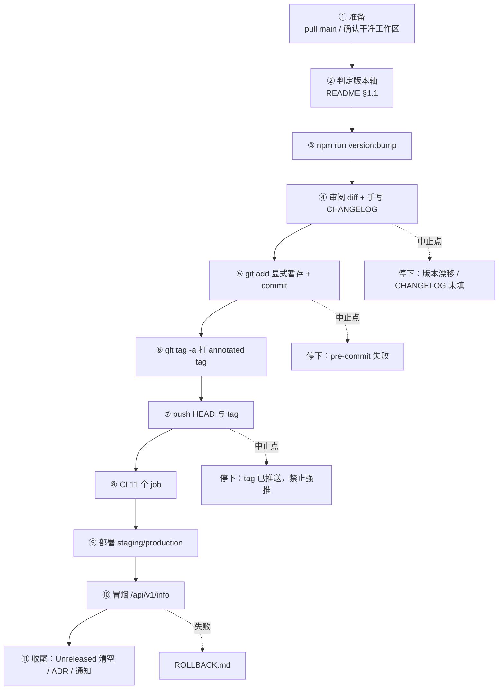

# 发布流程总览（Release SOP）

> **定位**：RMFOOD 平台「发布 / 打 tag / 回滚」的可执行操作手册。
> 版本治理的策略与决策依据见 [ADR-038 语义化版本发布体系](../adr/ADR-038-语义化版本发布体系.md)；
> 本文件只回答「现在该敲什么命令」，不重复论证「为什么这么设计」。
>
> **适用版本范围**：平台发布版本 `2.0.0` 及之后（tag `v2.0.0`，commit `5feace6`）。
> 配套可勾选清单：[CHECKLIST.md](./CHECKLIST.md)；回滚专题：[ROLLBACK.md](./ROLLBACK.md)。
>
> **环境基线（2026-10-25 实测）**：Windows + PowerShell 7（`pwsh`）、Node v22.22.0、Python 3.12、
> PostgreSQL 16、Redis 7、分支 `main`、远端 `https://github.com/RMFOOD/platform.git`。

---

## 0. 一分钟上手

```powershell
npm run version:current          # 看当前平台版本（读根 package.json）
npm run version:check            # 8 个承载点一致性门禁（秒级，零依赖）
npm run version:bump -- minor    # 2.0.0 -> 2.1.0，原子化改写 8 处 + CHANGELOG 骨架
git tag -a v2.1.0 -m "v2.1.0 - RMFOOD 平台 $(Get-Date -Format yyyy-MM-dd)"
git push origin HEAD && git push origin v2.1.0
```

`version:bump` **只改文件、不执行 `git commit`、不推送**——它打印待执行命令，由人工审阅 diff 后执行。
这是 ADR-038 的刻意约定，不要改成自动化。

---

## 1. 两个版本轴（正交，不得混用）

平台存在两条独立演进的版本轴。判定「这次改动动哪根轴」是发布流程的第一步。

| 轴 | 含义 | 权威定义位置 | 对外暴露方式 | 当前值 |
|:---|:-----|:-------------|:-------------|:-------|
| **A：平台发布版本** | 「整个平台迭代到第几代」 | 根 `package.json` 的 `version` | git tag、CHANGELOG、运行时 `settings.app_version`、`/api` 与 `/api/v1/info` 响应体 | `2.0.0` |
| **B：REST API 契约版本** | 「接口协议的第几版」 | `backend/app/api/api_version.py` 的 `CURRENT_API_VERSION` 与 `API_MATRIX` | `X-API-Version` 响应头、`/api/v1/info` 的 `api_version` | `1.0.0`（矩阵键名 `v1`） |

两轴不互推：平台 `2.x` 全程运行 API `v1`；平台 MAJOR 不必然意味着 API MAJOR，反之亦然。
实测（2026-10-25）`GET /api/v1/info` 返回 `{"api_version": "1.0.0", "app_version": "2.0.0"}`，两轴并列可见。

> ⚠️ 轴 B 自身的内部一致性问题（`CURRENT_API_VERSION = "1.0.0"` 与矩阵键名 `v1` 不对齐）
> 被 ADR-038 明确排除在外，改动会影响读取 `X-API-Version` 的下游客户端，需独立 ADR 处理。

### 1.1 改动 → 轴 判定表

按「最严重的那一项」取判定，多项命中时以高级别为准。

| 改动类型（具体可判断） | 轴 A（平台） | 轴 B（API 契约） |
|:---|:---:|:---:|
| 纯 UI 文案 / 样式 / 布局调整，零后端契约变化 | **PATCH** | — |
| 缺陷修复（bug fix），不改变公开行为 | **PATCH** | — |
| 无行为变化的内部重构（重命名私有函数、拆文件） | **PATCH** | — |
| 文档更新（README / docs / ADR / 注释） | **PATCH** | — |
| 测试补充、CI 配置调整、依赖的补丁版本升级 | **PATCH** | — |
| 新增页面 / Tab / 路由 | **MINOR** | — |
| 新增后端端点（向后兼容，老客户端不受影响） | **MINOR** | **MINOR** |
| 新增**可选**请求字段 | **MINOR** | **MINOR** |
| 响应体新增字段（客户端可忽略） | **MINOR** | **MINOR** |
| 新增数据库表、新增可空列或带默认值的列 | **MINOR** | — |
| 新增可配置项 / 环境变量（有安全默认值） | **MINOR** | — |
| 新增枚举值（对调用方向后兼容） | **MINOR** | **MINOR** |
| **删除或重命名响应字段** | **MAJOR** | **MAJOR** |
| **删除 / 重命名 / 路径变更 REST 端点** | **MAJOR** | **MAJOR** |
| 字段类型变更、必填性由可选改必填（老客户端破坏） | **MAJOR** | **MAJOR** |
| 错误码语义变更、分页 / 排序默认行为变更 | **MAJOR** | **MAJOR** |
| 认证 / 授权模型变更（JWT 时长、OAuth 提供方切换） | **MAJOR** | **MAJOR** |
| 删除枚举值、删除数据库列、改列类型 | **MAJOR** | 视是否经 API 暴露 |
| 数据库破坏性迁移（删表 / 跨表重组） | **MAJOR** | — |
| 运行时或部署模型破坏性变更（端口、启动方式、必需中间件） | **MAJOR** | — |
| 依赖主版本升级且引入破坏性变化 | **MAJOR** | 视契约影响 |
| 纯前端本地状态 / localStorage key 变更（无 API 交互） | — | — |
| 代码注释、空白、格式化、pre-commit 基线调整 | — | — |

补充说明：

- 「两者都不动」的行**不要**发布，直接合并即可，不消耗版本号。
- 「轴 A MAJOR + 轴 B MAJOR」的组合最常见于契约破坏；此时应同时新建 API 契约版本
  （在 `API_MATRIX` 登记 `v2`）并编写迁移期双写方案，见 ROLLBACK.md 场景 C。
- 数据库破坏性迁移单独触发轴 A MAJOR（ADR-038 规则），是否连带轴 B 取决于该列是否经 API 暴露。

### 1.2 bump 类型的触发条件（与仓库脚本实际实现一致）

`scripts/version/bump-version.js` 的 `bump()` 实现决定了实际产出的版本号：

| 类型 | 产出 | 触发条件 |
|:-----|:-----|:---------|
| `patch` | `2.0.0 → 2.0.1` | 上表中所有 **PATCH** 行；以及纯回滚 / revert 类提交 |
| `minor` | `2.0.0 → 2.1.0`（patch 归零） | 上表中所有 **MINOR** 行 |
| `major` | `2.0.0 → 3.0.0`（minor、patch 归零） | 上表中所有 **MAJOR** 行 |
| `rc` | `2.0.0 → 2.0.0-rc.1 → 2.0.0-rc.2 → …` | 准备正式发布前的候选验证；已存在 `rc.N` 时递增 N |

`rc` 的实际规则（实测源码 `version-sources.js` L284-L301）：

- 当前版本**无** prerelease 后缀 → 追加 `-rc.1`；
- 当前已是 `-rc.N` → 递增为 `-rc.(N+1)`；
- 当前是**其他** prerelease 后缀（例如 `-alpha.3`）→ 视为该候选结束，**推进 minor 并去掉后缀**
  （`2.0.0-alpha.3` → `2.0.1`），即作为正式版本发布。

---

## 2. 完整发布流程

### 2.1 流程图（纯文本）

```
 ┌──────────────────────────────────────────────────────────────────────────────┐
 │ ① 准备                                                                        │
 │   git switch main && git pull --ff-only                                      │
 │   git log --oneline v<上一个 tag>..HEAD     ← 看清本次发布实际涵盖哪些提交      │
 │   git status --porcelain                  ← 确认没有无关改动混入              │
 │   npm run version:current                                [中止点：非 main 分支] │
 └──────────────────────────────┬───────────────────────────────────────────────┘
                                ▼
 ┌──────────────────────────────────────────────────────────────────────────────┐
 │ ② 判定轴与 bump 类型                                                          │
 │   对照 §1.1 判定表 → 决定 patch / minor / major / rc                         │
 │   若命中轴 B MAJOR：先走 API 契约版本决策（新 ADR），再决定轴 A               │
 └──────────────────────────────┬───────────────────────────────────────────────┘
                                ▼
 ┌──────────────────────────────────────────────────────────────────────────────┐
 │ ③ bump（脚本只改文件，不 commit）                                             │
 │   npm run version:bump -- minor                                               │
 │   npm run version:check               ← 脚本已内置一次复核，此处再跑一次确认   │
 └──────────────────────────────┬───────────────────────────────────────────────┘
                                ▼
 ┌──────────────────────────────────────────────────────────────────────────────┐
 │ ④ 审阅 diff + 手写 CHANGELOG                                                  │
 │   git diff --stat                                                     [中止点] │
 │   git diff -- CHANGELOG.md                                                 │
 │   → 把 bump 生成的「待补充」占位替换成本版本实际变更明细（对照 git log）      │
 │   → 确认 8 个承载点全部指向同一版本号，禁止手工编辑单个承载点                │
 └──────────────────────────────┬───────────────────────────────────────────────┘
                                ▼
 ┌──────────────────────────────────────────────────────────────────────────────┐
 │ ⑤ 提交（显式暂存，禁止 git add -A）                                           │
 │   git add package.json frontend/package.json miniprogram/package.json        │
 │           backend/pyproject.toml backend/app/version.py                      │
 │           .env.example backend/.env.example CHANGELOG.md                     │
 │   git commit -m "release: v2.1.0 (ADR-038)"     ← pre-commit 钩子会自动跑     │
 │                                              print/console.log/as any/tsc     │
 │                                              ruff/ui-guard/scan_undefined    │
 └──────────────────────────────┬───────────────────────────────────────────────┘
                                ▼   [中止点：pre-commit 失败 → 修完再提交，不要 --no-verify]
 ┌──────────────────────────────────────────────────────────────────────────────┐
 │ ⑥ 打 tag（必须 annotated）                                                    │
 │   git tag -a v2.1.0 -m "v2.1.0 - RMFOOD 平台 2026-10-25"                     │
 │   git cat-file -t v2.1.0        → 必须输出 "tag"（不是 "commit"）             │
 └──────────────────────────────┬───────────────────────────────────────────────┘
                                ▼
 ┌──────────────────────────────────────────────────────────────────────────────┐
 │ ⑦ 推送                                                                        │
 │   git push origin HEAD        ← 先推提交                                      │
 │   git push origin v2.1.0      ← 再推 tag；两条必须都成功                      │
 └──────────────────────────────┬───────────────────────────────────────────────┘
                                ▼   [中止点：tag 已推送 → 不要强推改写，见 ROLLBACK.md 场景 B]
 ┌──────────────────────────────────────────────────────────────────────────────┐
 │ ⑧ CI 验证（.github/workflows/ci-cd.yml，共 11 个 job）                        │
 │   version-gate → lint → security-scan / test-backend / test-frontend /        │
 │   theme-gate（三者 needs: lint）→ build → deploy-staging / deploy-production  │
 │   → smoke-test → rollback（仅 main 且 smoke-test 失败时触发）                 │
 │   手动补跑：GitHub → Actions → workflow_dispatch → environment=production    │
 └──────────────────────────────┬───────────────────────────────────────────────┘
                                ▼
 ┌──────────────────────────────────────────────────────────────────────────────┐
 │ ⑨ 部署                                                                        │
 │   develop → deploy-staging 自动触发；main → deploy-production 自动触发       │
 │   生产主机上：docker compose pull && docker compose up -d                     │
 │   滚动顺序：先后端（/health 就绪探测）再前端                                  │
 │   本地验证（不使用 Docker）：.\start.ps1                                       │
 └──────────────────────────────┬───────────────────────────────────────────────┘
                                ▼
 ┌──────────────────────────────────────────────────────────────────────────────┐
 │ ⑩ 冒烟                                                                        │
 │   GET /api/v1/health     → status=healthy                                    │
 │   GET /api/v1/info       → app_version=2.1.0 且 api_version=1.0.0           │
 │   响应头 X-API-Version   → 1.0.0                                             │
 │   前端首页 HTTP 200                                                    [中止点]│
 │   → 任一项不符：立即 ROLLBACK.md，不要打下一个 tag                           │
 └──────────────────────────────┬───────────────────────────────────────────────┘
                                ▼
 ┌──────────────────────────────────────────────────────────────────────────────┐
 │ ⑪ 发布后收尾                                                                  │
 │   CHANGELOG [Unreleased] 段清空占位；docs/adr/ 补破坏性变更 ADR              │
 │   确认 README「版本与代际地图」同步；通知下游版本已发布                       │
 └──────────────────────────────────────────────────────────────────────────────┘
```

### 2.2 同一流程的 mermaid 版（供支持 mermaid 的渲染器）



---

## 3. 版本体系事实表（2026-10-25 实测）

### 3.1 单一权威源 + 8 个镜像承载点

单一权威源是**根 `package.json` 的 `version`**；其余 7 处为镜像。实测 `npm run version:check` 输出：

| # | 文件 | 角色 | 解析规则 | 实测值 |
|:-:|:-----|:-----|:---------|:------:|
| 1 | `package.json` | 权威源（平台版本） | JSON `.version` | 2.0.0 |
| 2 | `frontend/package.json` | Web 前端镜像 | JSON `.version` | 2.0.0 |
| 3 | `miniprogram/package.json` | 微信小程序镜像 | JSON `.version` | 2.0.0 |
| 4 | `backend/pyproject.toml` | 后端构建元数据 | `[project]` 段内 `version` | 2.0.0 |
| 5 | `backend/app/version.py` | 后端运行时事实源 | `__version__` | 2.0.0 |
| 6 | `.env.example` | 环境变量示例（根） | `APP_VERSION=` | 2.0.0 |
| 7 | `backend/.env.example` | 环境变量示例（后端） | `APP_VERSION=` | 2.0.0 |
| 8 | `CHANGELOG.md` | 变更历史条目 | 首个非 Unreleased 的 `## [x.y.z]` | 2.0.0 |

`{"ok": true, "exitCode": 0, "version": "2.0.0", "drifted": [], "missing": []}`

承载点清单的**两处定义必须逐项同步**：`scripts/version/version-sources.js` 的 `VERSION_SOURCES`
与 `backend/app/version.py` 的 `VERSION_SOURCE_FILES`。无自动化校验，任一侧增删承载点时必须同时改另一侧。

### 3.2 工具链（`scripts/version/`，零第三方依赖，仅 Node 内置模块）

| npm script | 实际命令 | 用途 |
|:-----------|:---------|:-----|
| `npm run version:check` | `node scripts/version/check-version.js` | 8 处一致性门禁，人类可读 |
| `npm run version:check:ci` | `node scripts/version/check-version.js --json` | 同上，JSON 输出供 CI |
| `npm run version:bump` | `node scripts/version/bump-version.js` | 原子化更新 8 处 + 写 CHANGELOG 骨架 |
| `npm run version:current` | `node -p "require('./package.json').version"` | 打印当前版本 |

`bump-version.js` 参数：`<patch\|minor\|major\|rc\|prerelease> [--tag] [--yes]`
- `--tag`：更新后直接执行 `git tag -a` 并推送（**本团队约定不使用**，见 §5）
- `--yes`：跳过确认提示

退出码：`check-version.js` → 0 全一致 / 1 存在漂移或缺失 / 2 参数错误或权威源缺失。

### 3.3 CI 门禁（`.github/workflows/ci-cd.yml`，实测 11 个 job）

| # | job | 依赖（`needs`） | 触发条件 | 要点 |
|:-:|:----|:----------------|:---------|:-----|
| 1 | `version-gate` | 无 | push / PR 均触发 | 与 `lint` **并行**、不跑 `npm ci`、秒级返回；执行 `node scripts/version/check-version.js --no-color` |
| 2 | `lint` | 无 | push / PR | ruff + eslint（`continue-on-error`）+ `tsc --noEmit` |
| 3 | `security-scan` | `lint` | push / PR | bandit + safety |
| 4 | `test-backend` | `lint` | push / PR | pytest + Alembic `heads`/`current` + 启动验证 + 辨证引擎评测 |
| 5 | `test-frontend` | `lint` | push / PR | `vitest run -c vitest.ci.config.ts --coverage` |
| 6 | `theme-gate` | `lint` | push / PR | 主题门禁（CI 无 dev server 降级为静态层 + M1） |
| 7 | `build` | `test-backend, test-frontend, security-scan` | 仅 push / workflow_dispatch | 构建并推送后端 + 前端镜像至 ghcr.io |
| 8 | `deploy-staging` | `build` | `develop` 或 `environment=staging` | SSH 到 staging 主机 `docker compose pull && up -d` |
| 9 | `deploy-production` | `build` | `main` 或 `environment=production` | 滚动更新：先后端（`/health` 探测）再前端 |
| 10 | `smoke-test` | `deploy-staging, deploy-production` | `always()` 且至少一个部署成功 | `/api/health` + 前端首页 200 |
| 11 | `rollback` | `smoke-test` | `failure()` 且 `github.ref == main` | 自动回滚到上一版本镜像 |

另有独立工作流 `.github/workflows/security-scan.yml`（定时触发）。

`version-gate` 在检测到 `package.json` 或 `CHANGELOG.md` 变更时会向 summary 打印提示：
CHANGELOG 需补全本区间实际变更明细并执行 `git tag -a v<版本号>`。

### 3.4 运行时版本注入链路

```
APP_VERSION 环境变量 ──┐
                      ├─→ Settings.app_version_override > app.version.__version__
backend/app/version.py ─┘        （backend/app/version.py:38 __version__ = "2.0.0"）
                                       │
                                       ▼
                      settings.app_version（config.py:692 扁平化属性）
                                       │
         ┌──────────────┬──────────────┼──────────────┬──────────────────┐
         ▼              ▼              ▼              ▼                  ▼
    app.version     /health      /api/v1/info      OpenAPI 文档     APIVersionMiddleware
                                                        注入 X-API-Version 响应头
```

- 优先级：**环境变量 `APP_VERSION` > 内嵌版本**（`config.py` L473-L475 `app_version_override`，`alias="APP_VERSION"`）。
  实测 `APP_VERSION=9.9.9` 覆盖成功。
- 部署环境可用该变量打补丁构建而不改代码；首次生产验证前需确认镜像确实注入了该变量。

### 3.5 数据库迁移

- 配置：`backend/alembic.ini`，`script_location = alembic` → 迁移目录 **`backend/alembic/versions/`**。
- 实测迁移文件数：**75 个**。
- 可用命令（`backend/requirements.txt` 中 `alembic==1.13.2`，venv 位于 `backend/venv/`）：
  ```powershell
  cd backend
  .\venv\Scripts\python.exe -m alembic current
  .\venv\Scripts\python.exe -m alembic heads
  .\venv\Scripts\python.exe -m alembic upgrade head
  .\venv\Scripts\python.exe -m alembic revision --autogenerate -m "描述"
  .\venv\Scripts\python.exe -m alembic downgrade -1
  ```
- 政策依据：[ADR-007 数据库迁移与版本管理策略](../adr/ADR-007-数据库迁移与版本管理策略.md)。
  注意 ADR-007 中写的迁移目录 `backend/app/migrations/versions/` 已过期，实测为 `backend/alembic/versions/`。

### 3.6 本地启动（不使用 Docker）

团队约定**本地开发不使用 Docker 直接启动**，用仓库根的两个脚本：

```powershell
.\start.ps1     # 清理 3000/8000 端口 → 校验依赖 → 启动后端 uvicorn:8000 + 前端 vite:3000
                #            → 轮询 http://127.0.0.1:8000/api/v1/health 与 :3000
.\stop.ps1      # 按端口 + 进程树清理（含 uvicorn --reload 的 reloader 父进程）
```

`start.ps1` 会注入开发用 `SECRET_KEY` 与 `ENV=development`；后端启动需完成建表 / 种子数据 / AI 服务初始化，
等待上限 480 秒，前端 120 秒。

仓库同时存在**部署用** Docker 资产（不参与本地开发，实测 2026-10-25）：
- 编排文件：根 `docker-compose.yml`、`docker/compose.prod.yml`；
- 根目录 4 个 Dockerfile 变体：`Dockerfile` / `Dockerfile.backend-only` /
  `Dockerfile.frontend-only` / `Dockerfile.optimized`；
- 子目录变体：`backend/Dockerfile.backend`（CI 回滚 job 引用此路径）、
  `frontend/Dockerfile` / `frontend/Dockerfile.frontend` / `frontend/docker/Dockerfile.prod`、
  `deploy/Dockerfile.deploy`、`.devcontainer/Dockerfile`；
- `docker/` 下另有可观测性组件配置（prometheus / grafana / loki / tempo / alertmanager / nginx）。

CI 的 `build` job 以仓库根为 context，用主 `Dockerfile` 的 `backend-production` /
`frontend-production` build target 出镜像；`rollback` job 通过
`git show <prev>:backend/Dockerfile.backend` 读取历史镜像 tag。
CI 的生产部署在远端主机的 `/opt/rmfood` 目录执行 `docker compose pull && docker compose up -d`。
部署细节见 [docs/deployment/DEPLOYMENT_GUIDE.md](../deployment/DEPLOYMENT_GUIDE.md)。

---

## 4. 关键约束清单

1. **`bump-version.js` 不代你 commit。** 它只改文件、打印 `git add` / `git commit` / `git tag` / `git push`
   待执行命令，目的是让人工审阅完整 diff。不要加 `--tag` 绕过审阅。
2. **禁止手工编辑任何一个版本承载点。** 8 处由脚本原子化更新；手工改一处必然造成漂移，
   由 CI 的 `version-gate` job 拦截。修复方式永远是 `npm run version:bump -- patch` 统一。
3. **tag 必须是 annotated tag（`git tag -a`）。** 轻量 tag 没有独立对象、不携带发布说明，无法审计。
   验证：`git cat-file -t v2.1.0` 必须输出 `tag`。
4. **CHANGELOG 必须手写本次改动。** `bump-version.js` 只生成条目骨架和「**待补充**」占位，
   实际明细必须对照 `git log v<上一个 tag>..HEAD` 补齐。刻意不做自动 changelog 生成
   ——本项目约 48% 提交是 `fix`，自动生成会产出无意义噪声。
5. **不要使用 `git add -A` 提交发布。** 显式暂存 §2.1 ⑤ 列出的 8 个文件，避免把并发任务的
   WIP 改动混进发布提交（本仓库为多人/多任务共享工作区，实测存在数百处未提交改动，数量随时变化）。
6. **不要使用 `--no-verify` 跳过 pre-commit。** `.husky/pre-commit` 会跑 print() / console.log /
   as any / `tsc --noEmit` / ruff / ui-guard / scan_undefined，其中若干是 500 级隐患的拦截网。
7. **tag 一旦推送，不要强推改写。** 走 [ROLLBACK.md](./ROLLBACK.md) 场景 B 的替代路径
   （重建新 tag，如 `v2.0.1`），并通知下游。
8. **轴 A 与轴 B 不得混用。** 平台 MAJOR 不自动意味着 API MAJOR。改 `CURRENT_API_VERSION`
   属于轴 B 治理，超出 ADR-038 范围，需独立 ADR。
9. **数据库迁移前必备份**，且破坏性迁移必须走 ROLLBACK.md 场景 D 的判定流程；
   已有业务数据依赖新 schema 时**绝对不能自动回滚**。
10. **回滚用 `git revert`，不用 `git reset --hard`。** 已推送历史是团队共享事实，不可改写。
11. **发布验证以运行时为准，不以代码为准。** `npm run version:current` 读的是本地文件；
    部署后必须以 `GET /api/v1/info` 的 `app_version` 字段为准。
12. **小程序包版本号不纳入本体系。** 微信开发者工具的 `project.config.json` 使用独立版本体系，
    `miniprogram/package.json` 仅作平台版本镜像，不承担发布语义（ADR-038 明确排除）。
13. **AI 模块内部版本号不纳入本体系。** `frontend/src/components/ai/features/CHANGELOG.md` 的
    `8.0.0` 与源码内 `v9.0` 标记是模块内部代号，与平台版本正交（ADR-038 明确排除）。

---

## 5. 相关文档

| 文档 | 路径 |
|:-----|:-----|
| 版本治理策略与决策（权威） | [ADR-038 语义化版本发布体系](../adr/ADR-038-语义化版本发布体系.md) |
| ADR 索引 | [docs/adr/index.md](../adr/index.md) |
| 变更历史（单一事实源之一） | [CHANGELOG.md](../../CHANGELOG.md) |
| 可勾选发布清单 | [CHECKLIST.md](./CHECKLIST.md) |
| 回滚指南 | [ROLLBACK.md](./ROLLBACK.md) |
| 数据库迁移策略 | [ADR-007](../adr/ADR-007-数据库迁移与版本管理策略.md) |
| CI/CD 策略 | [ADR-008](../adr/ADR-008-CI-CD流水线与持续交付策略.md) |
| 部署文档集 | [docs/deployment/](../deployment/) |
