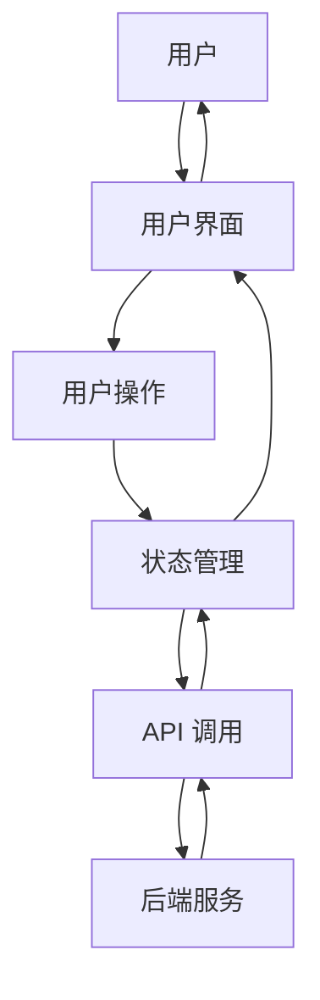
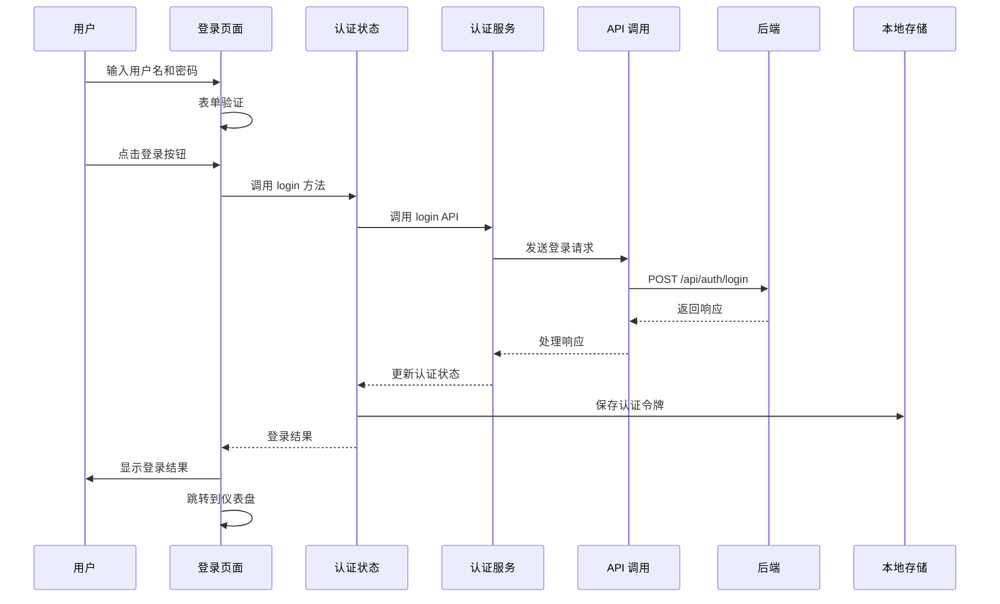
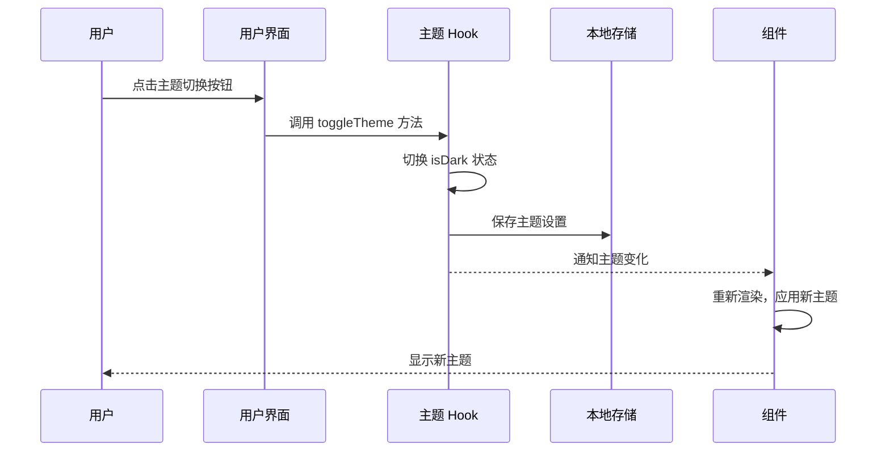

# RMFOOD 前端数据流程和状态管理设计文档

## 1. 数据流程设计

### 1.1 整体数据流程



### 1.2 登录流程数据流向



### 1.3 主题切换流程数据流向



## 2. 状态管理方案

### 2.1 状态管理架构

采用 Zustand 作为状态管理库，具有以下优势：
- 轻量级，无 boilerplate 代码
- 支持 TypeScript
- 简单易用的 API
- 支持中间件
- 性能优化

### 2.2 状态存储设计

#### 2.2.1 认证状态存储 (`src/stores/auth.ts`)

```typescript
interface AuthState {
  user: User | null;
  token: string | null;
  isAuthenticated: boolean;
  isLoading: boolean;
  error: string | null;
  login: (username: string, password: string) => Promise<void>;
  logout: () => void;
  clearError: () => void;
}

const useAuthStore = create<AuthState>((set) => ({
  user: null,
  token: localStorage.getItem('token'),
  isAuthenticated: !!localStorage.getItem('token'),
  isLoading: false,
  error: null,
  login: async (username, password) => {
    set({ isLoading: true, error: null });
    try {
      const response = await authService.login(username, password);
      const { access_token, user } = response;
      localStorage.setItem('token', access_token);
      set({ 
        user, 
        token: access_token, 
        isAuthenticated: true, 
        isLoading: false 
      });
    } catch (error: any) {
      set({ 
        error: error.response?.data?.message || '登录失败', 
        isLoading: false 
      });
    }
  },
  logout: () => {
    localStorage.removeItem('token');
    set({ 
      user: null, 
      token: null, 
      isAuthenticated: false 
    });
  },
  clearError: () => {
    set({ error: null });
  },
}));
```

#### 2.2.2 主题状态存储 (`src/hooks/useTheme.ts`)

```typescript
interface ThemeState {
  isDark: boolean;
  toggleTheme: () => void;
}

const useTheme = (): ThemeState => {
  const [isDark, setIsDark] = useState(() => {
    const savedTheme = localStorage.getItem('theme');
    if (savedTheme) {
      return savedTheme === 'dark';
    }
    return window.matchMedia('(prefers-color-scheme: dark)').matches;
  });

  const toggleTheme = useCallback(() => {
    setIsDark((prev) => {
      const newTheme = !prev;
      localStorage.setItem('theme', newTheme ? 'dark' : 'light');
      document.documentElement.classList.toggle('dark', newTheme);
      return newTheme;
    });
  }, []);

  useEffect(() => {
    document.documentElement.classList.toggle('dark', isDark);
  }, [isDark]);

  return { isDark, toggleTheme };
};
```

### 2.3 状态更新机制

1. **同步状态更新**：直接调用 set 函数更新状态
2. **异步状态更新**：使用 async/await 处理异步操作，如 API 调用
3. **批量更新**：在一个函数中多次调用 set，Zustand 会自动批量处理
4. **中间件**：使用中间件处理日志、持久化等操作

### 2.4 状态持久化

- **认证令牌**：使用 localStorage 存储，确保刷新页面后仍然保持登录状态
- **主题设置**：使用 localStorage 存储，确保刷新页面后仍然保持主题设置
- **用户偏好**：使用 localStorage 存储用户偏好设置

## 3. 数据存储策略

### 3.1 本地存储

| 存储项 | 类型 | 用途 | 持久化方式 |
|-------|------|------|------------|
| `token` | string | 认证令牌 | localStorage |
| `theme` | string | 主题设置 | localStorage |
| `remember_me` | string | 记住登录状态 | localStorage |
| `username` | string | 记住用户名 | localStorage |

### 3.2 内存存储

| 存储项 | 类型 | 用途 | 持久化方式 |
|-------|------|------|------------|
| `user` | object | 用户信息 | 内存，刷新页面后从 token 重新获取 |
| `isLoading` | boolean | 加载状态 | 内存，刷新页面后重置 |
| `error` | string | 错误信息 | 内存，刷新页面后重置 |

## 4. 性能优化

### 4.1 状态管理优化

1. **选择器优化**：使用 Zustand 的选择器功能，只订阅需要的状态
2. **防抖和节流**：对频繁触发的状态更新使用防抖和节流
3. **批量更新**：合并多个状态更新为一个批次
4. **中间件**：使用中间件优化状态管理

### 4.2 数据获取优化

1. **缓存**：使用 React Query 缓存 API 响应
2. **预加载**：预加载可能需要的数据
3. **按需加载**：只加载当前需要的数据
4. **错误重试**：对 API 调用失败进行合理的重试

### 4.3 渲染优化

1. **使用 useCallback**：缓存函数，减少不必要的重渲染
2. **使用 useMemo**：缓存计算结果，减少重复计算
3. **使用 React.memo**：缓存组件，减少不必要的重渲染
4. **虚拟滚动**：对长列表使用虚拟滚动

## 5. 安全性考虑

### 5.1 数据安全

1. **令牌安全**：使用 HTTPS 传输令牌，避免令牌泄露
2. **存储安全**：不要在 localStorage 中存储敏感信息
3. **输入验证**：对用户输入进行严格验证
4. **API 安全**：使用 API 密钥和令牌验证

### 5.2 状态管理安全

1. **状态隔离**：不同模块的状态相互隔离，避免状态污染
2. **权限控制**：根据用户权限控制状态访问
3. **错误处理**：妥善处理状态更新中的错误
4. **日志记录**：记录重要的状态更新和错误

## 6. 测试策略

### 6.1 状态管理测试

1. **单元测试**：测试状态更新函数
2. **集成测试**：测试状态管理与组件的交互
3. **模拟测试**：模拟 API 调用和本地存储
4. **性能测试**：测试状态更新的性能

### 6.2 数据流程测试

1. **端到端测试**：测试完整的数据流程
2. **边界测试**：测试边界情况的数据流程
3. **错误测试**：测试错误情况下的数据流程
4. **并发测试**：测试并发操作的数据流程

## 7. 结论

本数据流程和状态管理设计文档详细说明了 RMFOOD 前端应用的数据流程和状态管理方案。通过合理的状态管理和数据流程设计，我们可以实现高效、安全、可靠的前端应用。

后续的开发工作将按照本设计文档的指导进行，确保数据流程的顺畅和状态管理的高效。