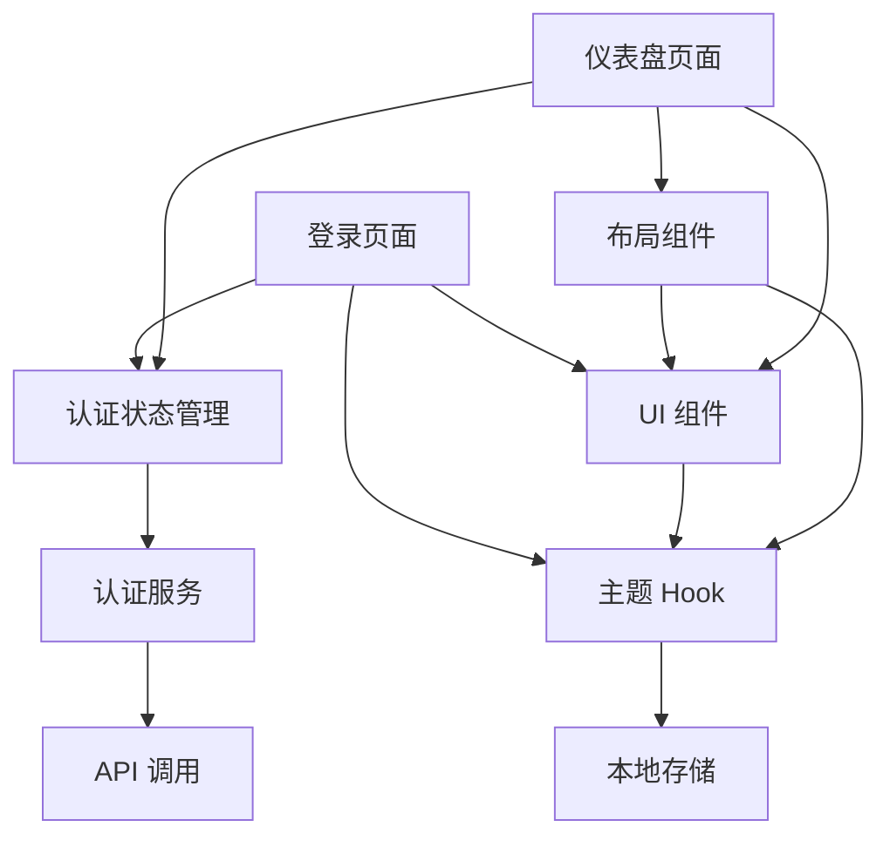

# RMFOOD 前端功能模块设计文档

## 1. 模块划分

根据系统功能需求，将前端应用划分为以下核心模块：

| 模块名称 | 主要职责 | 文件位置 | 依赖关系 |
|---------|---------|---------|----------|
| 登录模块 | 用户登录、密码重置、第三方登录 | `src/pages/auth/LoginPage.tsx` | 认证模块、主题模块 |
| 认证模块 | 用户认证、令牌管理、会话管理 | `src/stores/auth.ts`、`src/services/auth.ts` | API 模块 |
| 主题模块 | 明暗主题切换、主题持久化 | `src/hooks/useTheme.ts` | 本地存储 |
| UI 组件模块 | 可复用的 UI 组件 | `src/components/ui/` | 无 |
| 布局模块 | 页面布局组件 | `src/components/layout/` | 主题模块 |
| 配置模块 | 应用配置管理 | `src/config/` | 无 |
| API 模块 | 后端 API 调用 | `src/services/` | 无 |
| 工具模块 | 通用工具函数 | `src/utils/` | 无 |

## 2. 模块详细设计

### 2.1 登录模块

#### 2.1.1 功能职责
- 提供用户登录界面
- 实现表单验证
- 处理登录逻辑
- 支持第三方登录
- 显示错误信息
- 适配明暗主题

#### 2.1.2 核心组件
- **LoginPage**：主登录页面组件
- **Input**：输入框组件
- **Button**：按钮组件
- **Checkbox**：复选框组件

#### 2.1.3 接口定义

| 接口名称 | 描述 | 参数 | 返回值 |
|---------|------|------|--------|
| `handleSubmit` | 处理表单提交 | `e: React.SubmitEvent` | `Promise<void>` |
| `handleUsernameChange` | 处理用户名输入变化 | `e: React.ChangeEvent<HTMLInputElement>` | `void` |
| `handlePasswordChange` | 处理密码输入变化 | `e: React.ChangeEvent<HTMLInputElement>` | `void` |
| `validateUsername` | 验证用户名 | `username: string` | `string` (错误信息) |
| `validatePassword` | 验证密码 | `password: string` | `string` (错误信息) |

### 2.2 认证模块

#### 2.2.1 功能职责
- 管理用户认证状态
- 处理登录、登出逻辑
- 管理认证令牌
- 提供认证相关的 API 调用

#### 2.2.2 核心文件
- **auth.ts** (store)：认证状态管理
- **auth.ts** (service)：认证 API 调用

#### 2.2.3 接口定义

| 接口名称 | 描述 | 参数 | 返回值 |
|---------|------|------|--------|
| `login` | 用户登录 | `username: string, password: string` | `Promise<void>` |
| `logout` | 用户登出 | 无 | `void` |
| `getUser` | 获取当前用户信息 | 无 | `User | null` |
| `isAuthenticated` | 检查用户是否已认证 | 无 | `boolean` |

### 2.3 主题模块

#### 2.3.1 功能职责
- 管理应用主题（明/暗模式）
- 提供主题切换功能
- 主题设置持久化
- 为组件提供主题相关的样式

#### 2.3.2 核心文件
- **useTheme.ts**：主题管理 Hook

#### 2.3.3 接口定义

| 接口名称 | 描述 | 参数 | 返回值 |
|---------|------|------|--------|
| `useTheme` | 主题管理 Hook | 无 | `{ isDark: boolean, toggleTheme: () => void }` |
| `toggleTheme` | 切换主题 | 无 | `void` |
| `isDark` | 当前主题状态 | 无 | `boolean` |

### 2.4 UI 组件模块

#### 2.4.1 功能职责
- 提供可复用的 UI 组件
- 支持主题适配
- 确保组件的可访问性
- 提供一致的视觉风格

#### 2.4.2 核心组件
- **Input**：输入框组件
- **Button**：按钮组件
- **Checkbox**：复选框组件
- **Card**：卡片组件
- **Icon**：图标组件

#### 2.4.3 接口定义

| 组件名称 | 描述 | 主要 props |
|---------|------|-----------|
| `Input` | 输入框 | `id, value, onChange, placeholder, required, className` |
| `Button` | 按钮 | `type, size, variant, loading, icon, className, onClick` |
| `Checkbox` | 复选框 | `id, checked, onCheckedChange, aria-label` |
| `Card` | 卡片 | `children, className` |
| `Icon` | 图标 | `name, size, className` |

### 2.5 布局模块

#### 2.5.1 功能职责
- 提供页面布局结构
- 管理页面导航
- 支持响应式布局
- 适配不同屏幕尺寸

#### 2.5.2 核心组件
- **Layout**：主布局组件
- **Header**：页头组件
- **Sidebar**：侧边栏组件
- **Footer**：页脚组件

#### 2.5.3 接口定义

| 组件名称 | 描述 | 主要 props |
|---------|------|-----------|
| `Layout` | 主布局 | `children` |
| `Header` | 页头 | `title, user` |
| `Sidebar` | 侧边栏 | `items, activeItem` |
| `Footer` | 页脚 | `copyright` |

### 2.6 配置模块

#### 2.6.1 功能职责
- 管理应用配置
- 提供常量定义
- 集中管理配置信息

#### 2.6.2 核心文件
- **index.ts**：主配置文件
- **auth.ts**：认证相关配置
- **theme.ts**：主题相关配置

#### 2.6.3 配置项

| 配置项 | 描述 | 值类型 |
|-------|------|--------|
| `BRAND_CONFIG` | 品牌配置 | `object` |
| `LOGIN_PAGE_CONFIG` | 登录页面配置 | `object` |
| `THEME_CONFIG` | 主题配置 | `object` |
| `API_CONFIG` | API 配置 | `object` |

### 2.7 API 模块

#### 2.7.1 功能职责
- 封装后端 API 调用
- 处理 API 响应
- 管理 API 错误
- 提供统一的 API 接口

#### 2.7.2 核心文件
- **auth.ts**：认证相关 API
- **formula.ts**：配方相关 API
- **ingredient.ts**：原料相关 API

#### 2.7.3 接口定义

| 接口名称 | 描述 | 参数 | 返回值 |
|---------|------|------|--------|
| `login` | 用户登录 | `username: string, password: string` | `Promise<{ access_token: string, user: User }>` |
| `logout` | 用户登出 | 无 | `Promise<{ message: string }>` |
| `getUser` | 获取用户信息 | 无 | `Promise<User>` |

### 2.8 工具模块

#### 2.8.1 功能职责
- 提供通用工具函数
- 封装常用操作
- 提高代码复用性

#### 2.8.2 核心文件
- **validation.ts**：表单验证工具
- **storage.ts**：本地存储工具
- **format.ts**：格式化工具
- **http.ts**：HTTP 工具

#### 2.8.3 接口定义

| 函数名称 | 描述 | 参数 | 返回值 |
|---------|------|------|--------|
| `validateEmail` | 验证邮箱 | `email: string` | `boolean` |
| `validatePassword` | 验证密码强度 | `password: string` | `{ isValid: boolean, errors: string[] }` |
| `setStorage` | 设置本地存储 | `key: string, value: any` | `void` |
| `getStorage` | 获取本地存储 | `key: string` | `any` |
| `removeStorage` | 删除本地存储 | `key: string` | `void` |

## 3. 模块间依赖关系

## 4. 数据流设计

### 4.1 登录流程

1. 用户在登录页面输入用户名和密码
2. 表单验证函数验证输入
3. 点击登录按钮，调用 `handleSubmit` 函数
4. `handleSubmit` 调用 `useAuthStore` 中的 `login` 方法
5. `login` 方法调用 `authService.login` API
6. API 调用成功后，保存认证令牌到本地存储
7. 更新 `useAuthStore` 中的用户状态
8. 跳转到仪表盘页面

### 4.2 主题切换流程

1. 用户点击主题切换按钮
2. 调用 `useTheme` 中的 `toggleTheme` 方法
3. `toggleTheme` 方法切换 `isDark` 状态
4. 将新的主题状态保存到本地存储
5. 触发组件重新渲染，应用新的主题样式

## 5. 接口规范

### 5.1 命名规范

- **组件名称**：使用 PascalCase，如 `LoginPage`
- **函数名称**：使用 camelCase，如 `handleSubmit`
- **变量名称**：使用 camelCase，如 `username`
- **常量名称**：使用 UPPER_CASE，如 `BRAND_CONFIG`
- **文件名称**：使用 kebab-case，如 `login-page.tsx`

### 5.2 类型定义

- 使用 TypeScript 接口定义数据结构
- 为所有函数参数和返回值添加类型
- 使用联合类型和可选类型提高类型安全性

### 5.3 错误处理

- 使用 try-catch 捕获异步错误
- 为 API 调用添加错误处理
- 显示用户友好的错误信息
- 记录错误日志

### 5.4 可访问性

- 为所有交互元素添加 ARIA 属性
- 确保表单元素有正确的标签关联
- 支持键盘导航
- 确保颜色对比度符合 WCAG 2.1 AA 级标准

## 6. 结论

本功能模块设计文档详细定义了 RMFOOD 前端应用的功能模块、职责和接口。通过模块化的设计，我们可以实现代码的高内聚、低耦合，提高代码的可维护性和可扩展性。

后续的开发工作将按照本设计文档的指导进行，确保各个模块能够协同工作，实现系统的整体功能。