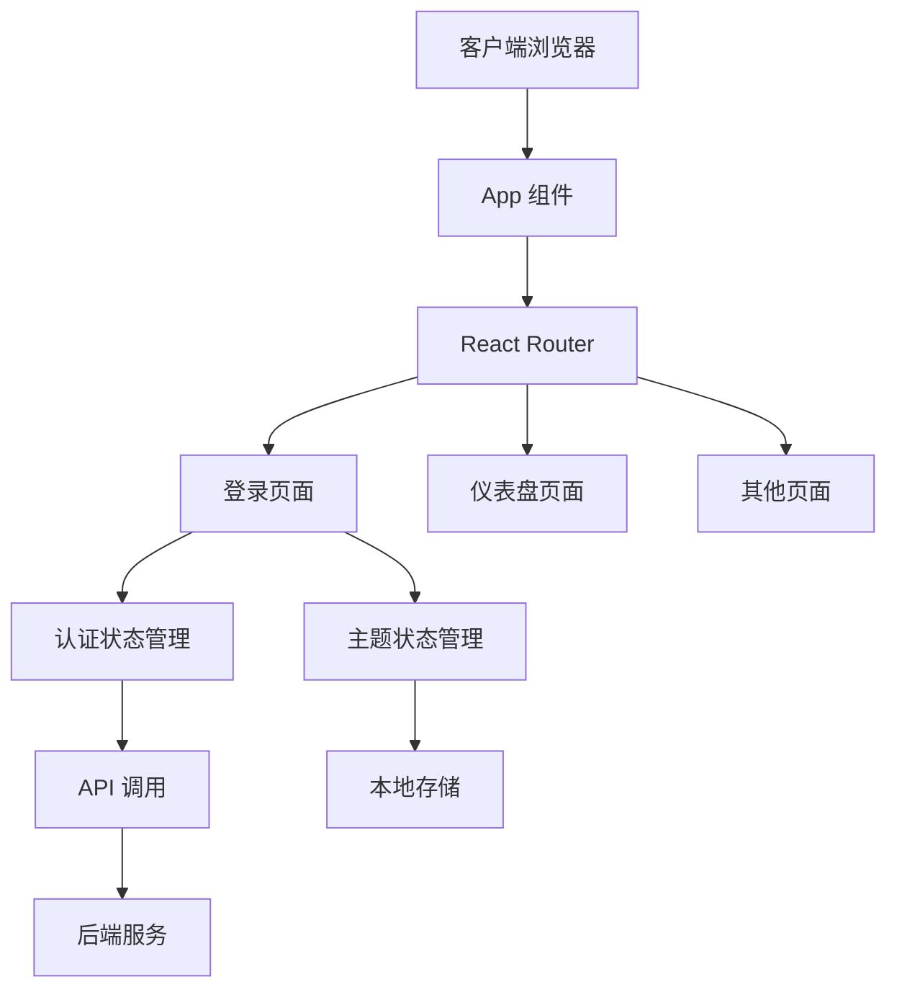

# RMFOOD 前端技术架构设计文档

## 1. 系统概述

RMFOOD 是一个药食同源功能性食品专业配方研发平台，前端采用现代化的 React 技术栈，提供专业、美观、易用的用户界面。本次设计主要针对登录页面的优化，包括 UI 设计、主题切换、响应式布局等功能。

## 2. 技术栈选型

| 类别 | 技术/库 | 版本 | 用途 |
|------|---------|------|------|
| 核心框架 | React | 19.0.0 | 前端 UI 构建 |
| 路由 | React Router | 7.0.0 | 页面路由管理 |
| 状态管理 | Zustand | 4.4.0 | 全局状态管理 |
| 样式 | Tailwind CSS | 4.0.0 | 响应式样式设计 |
| 图标 | Lucide React | 0.300.0 | 图标库 |
| 数据请求 | Axios | 1.6.0 | HTTP 客户端 |
| 数据查询 | React Query | 5.0.0 | 数据获取和缓存 |
| 构建工具 | Vite | 5.0.0 | 项目构建和开发服务器 |
| 类型检查 | TypeScript | 5.3.0 | 类型安全 |
| 测试 | Jest | 29.7.0 | 单元测试 |
| 测试库 | React Testing Library | 14.1.0 | 组件测试 |

## 3. 系统架构

### 3.1 架构图



### 3.2 核心架构原则

1. **组件化设计**：将 UI 拆分为可复用的组件，提高代码可维护性
2. **状态管理**：使用 Zustand 管理全局状态，保持状态逻辑清晰
3. **响应式设计**：使用 Tailwind CSS 实现响应式布局，确保在不同设备上的良好体验
4. **主题系统**：实现明暗主题切换，提升用户体验
5. **可访问性**：符合 WCAG 2.1 AA 级标准，确保所有用户都能使用
6. **性能优化**：使用 React 最佳实践，减少不必要的重渲染

## 4. 目录结构

```
frontend/
├── src/
│   ├── components/         # 可复用组件
│   │   ├── ui/             # UI 组件
│   │   └── layout/         # 布局组件
│   ├── pages/              # 页面组件
│   │   ├── auth/           # 认证相关页面
│   │   │   └── LoginPage.tsx  # 登录页面
│   │   └── dashboard/      # 仪表盘页面
│   ├── hooks/              # 自定义 Hooks
│   │   └── useTheme.ts     # 主题管理 Hook
│   ├── stores/             # 状态管理
│   │   └── auth.ts         # 认证状态
│   ├── services/           # API 服务
│   │   └── auth.ts         # 认证相关 API
│   ├── config/             # 配置文件
│   ├── utils/              # 工具函数
│   ├── tests/              # 测试文件
│   ├── index.css           # 全局样式
│   ├── App.tsx             # 应用根组件
│   └── main.tsx            # 应用入口
├── public/                 # 静态资源
├── docs/                   # 文档
├── package.json            # 项目配置
├── tsconfig.json           # TypeScript 配置
└── vite.config.ts          # Vite 配置
```

## 5. 核心功能模块

### 5.1 登录页面模块

- **功能**：用户登录、密码重置、第三方登录
- **组件**：LoginPage.tsx
- **状态管理**：useAuthStore
- **API**：/api/auth/login

### 5.2 主题管理模块

- **功能**：明暗主题切换、主题持久化
- **组件**：useTheme Hook
- **状态管理**：useTheme
- **存储**：localStorage

### 5.3 认证模块

- **功能**：用户认证、令牌管理、会话管理
- **服务**：auth.ts
- **状态管理**：useAuthStore
- **API**：/api/auth/*

## 6. 数据流程

### 6.1 登录流程

1. 用户输入用户名和密码
2. 表单验证
3. 调用登录 API
4. 保存认证令牌到本地存储
5. 跳转到仪表盘页面

### 6.2 主题切换流程

1. 用户切换主题
2. 更新主题状态
3. 保存主题设置到本地存储
4. 重新渲染页面组件

## 7. 接口设计

### 7.1 前端内部接口

| 接口 | 描述 | 参数 | 返回值 |
|------|------|------|--------|
| useAuthStore | 认证状态管理 | 无 | { login, logout, user, isAuthenticated } |
| useTheme | 主题管理 | 无 | { isDark, toggleTheme } |
| validateUsername | 用户名验证 | username: string | error: string |
| validatePassword | 密码验证 | password: string | error: string |

### 7.2 后端 API 接口

| 接口 | 方法 | 描述 | 请求体 | 成功响应 |
|------|------|------|--------|----------|
| /api/auth/login | POST | 用户登录 | { username: string, password: string } | { access_token: string, user: object } |
| /api/auth/logout | POST | 用户登出 | 无 | { message: string } |
| /api/auth/refresh | POST | 刷新令牌 | { refresh_token: string } | { access_token: string } |

## 8. 安全性考虑

1. **密码加密**：使用 HTTPS 传输密码，后端使用 bcrypt 等算法加密存储
2. **令牌管理**：使用 JWT 令牌，设置合理的过期时间
3. **CSRF 防护**：实现 CSRF 令牌验证
4. **XSS 防护**：使用 React 的安全渲染机制，避免 XSS 攻击
5. **输入验证**：前端和后端双重验证用户输入
6. **Rate Limiting**：对登录接口实施速率限制，防止暴力破解

## 9. 性能优化策略

1. **代码分割**：使用 React.lazy 和 Suspense 实现代码分割
2. **组件优化**：使用 useCallback、useMemo 减少不必要的重渲染
3. **图片优化**：使用适当尺寸的图片，实现懒加载
4. **网络优化**：使用 HTTP/2、缓存策略减少网络请求
5. **构建优化**：使用 Vite 的生产构建，优化打包大小
6. **动画优化**：使用 CSS 动画和 transform，避免重排

## 10. 测试策略

1. **单元测试**：测试单个组件和函数
2. **集成测试**：测试组件之间的交互
3. **E2E 测试**：测试完整的用户流程
4. **性能测试**：测试页面加载速度和响应时间
5. **可访问性测试**：测试页面的可访问性

## 11. 部署策略

1. **构建**：使用 Vite 构建生产版本
2. **静态部署**：部署到静态文件服务器
3. **CDN**：使用 CDN 加速静态资源
4. **CI/CD**：配置持续集成和持续部署流程

## 12. 结论

本技术架构设计文档为 RMFOOD 前端项目提供了清晰的技术路线和实施指南。通过采用现代化的 React 技术栈和最佳实践，我们可以构建一个专业、美观、易用的药食同源功能性食品配方研发平台。

后续的开发工作将按照本设计文档的指导进行，确保系统的质量和性能达到预期目标。